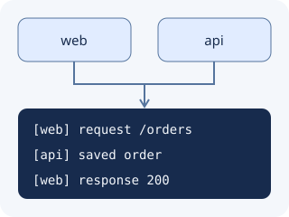

# Agent CLI Contract

[English](./agent-cli.md) · [繁體中文](./agent-cli.zh-TW.md)

Use Orbit's structured CLI output to inspect runtime state and recover from
errors in a coding agent or script. This contract defines JSON responses, log
streams, error codes, and recommended actions.

## Rule of Thumb

Use `--json` for programmatic reads and writes:

```bash
orbit status --json
orbit doctor --json
orbit up --infra --json
orbit logs redis --json
```

Human output is optimized for terminals and may change. JSON output is the
agent-facing contract.

## JSON Envelope

Commands converted to the agent contract return one JSON object with this
top-level shape:

```json
{
  "schema_version": "orbit.cli.v1",
  "ok": true,
  "command": "doctor",
  "instance": "ci-123",
  "data": {},
  "error": null,
  "notices": [],
  "recommended_actions": []
}
```

Fields:

| Field | Meaning |
|---|---|
| `schema_version` | Contract version. Current value is `orbit.cli.v1`. |
| `ok` | `true` on success, `false` on failure. |
| `command` | The Orbit command that produced the response. URL credentials (userinfo and the query string) in a URL argument are removed, as in messages and recommended actions. An SSH URL (`ssh://`, `git+ssh://`, `ssh+git://`) keeps its username, which names the login rather than a secret; its password is still removed. |
| `instance` | Named runtime targeted by `--instance`, omitted for the default runtime. |
| `data` | Command-specific payload on success. |
| `error` | Structured error payload on failure, otherwise `null`. |
| `notices` | Structured non-failing events, such as a one-time legacy source migration. |
| `recommended_actions` | Follow-up commands the agent should consider. |

Every lifecycle command accepts `--instance <name>`. Use `orbit instance list
--json` to discover each instance's environment, daemon state, dashboard, and
resolved resource endpoints. `orbit instance clean <name> --json` stops the
instance and removes only resources carrying that instance's ownership. Its
`data` is `{instance, removed}`, plus `skipped_processes[]` (`service`, `pid`,
`reason`) when it left recorded PIDs running, either unproven or failing to
stop.
Recommended actions emitted for a named runtime retain that instance target.
The full targeting and cleanup model is documented in
[Isolated runtime instances](instances.md).

When a converted command fails with `--json`, Orbit prints a single JSON object
to stdout and exits with code `1`.

`orbit up --json` and `orbit env apply --json` share one operation-wide
`--timeout` with a five-minute default. The deadline starts when command
execution begins and bounds daemon readiness, lifecycle RPCs, status polling,
and failure-evidence collection. Deadline exhaustion returns `timeout`;
caller or catchable-signal cancellation returns `canceled`. If an environment
reconcile request was dispatched, the canceled message states that the daemon
may have accepted it and recommends `orbit status --json`.

## Streams

`stdout` carries the envelope and nothing else. Parse it alone.

`stderr` carries diagnostics and progress for humans, and is not part of the
contract — its content and wording may change between releases. `orbit up
--json` and `orbit env apply --json` announce a small number of lifecycle phase
changes there. If a phase stays unchanged for 30 seconds, they add elapsed time
and an approximate remaining operation budget. During readiness, a resource
heartbeat replaces the generic phase heartbeat for that interval:

```
⋯ ensuring daemon
⋯ waiting for readiness
⋯ api still starting (elapsed 30s, about 4m29s remaining)
```

Phase wording and timing are diagnostic, not stable values for agents to parse.
Use the final envelope for decisions.

Merging `stderr` into `stdout` before parsing will break: progress lines are
not JSON. Redirect them separately, or discard `stderr` if only the envelope
matters.

### Lifecycle observation

`down` and `restart` acknowledge accepted work promptly. Their final JSON data
adds `operation_id`, `operation_state` and `elapsed_ms` when an operation is
available. Elapsed time measures this command's observation, including
preparation; daemon acceptance has its own timestamp. An operation failure can
be reported even if all tracked resources already look stopped. Restart still
waits for readiness after its stop/start dispatch succeeds.
`operation_state: "unknown"` means the result could not be observed; it is not
a daemon failure or success.
If no post-acceptance snapshot was observed, `resources` is empty rather than
presenting a pre-command snapshot as the final state.

Progress stays on stderr in JSON mode. Human output also reports phases,
resource changes and elapsed heartbeats when output is piped or color is off.
`orbit down --timeout 30s` bounds observation. A timeout or Ctrl-C does not undo
accepted daemon work: preserve the operation ID and run `orbit operation <id> --json`
before another mutation. Without an ID, inspect `orbit status --json`. An older daemon without operation IDs uses the legacy
state wait and explicitly reports that a definitive operation result is absent.

Human `up --timeout` retains its readiness budget, including failure-log
collection. Preparation remains cancellable. JSON `up` and `env apply` retain
their whole-command budget, including preparation.

Query with the same `--instance` and explicit `--config` flags used by the
original command. `orbit operation <id> --json` is read-only: it does not start
a daemon, create an instance, load the current project config, apply pending
environment changes or recover an update transaction. A changed or deleted
config does not prevent reading the original context.

A successful lookup returns `ok: true` and exits zero even when
`data.state` is `failed`. Inspect that state, `error`, `code`, `cleanup` and
`warnings` for the original outcome. Lookup failures return `ok: false` and a
nonzero exit; unavailable history never proves success. Human output makes the
same distinction. Accepted/running results recommend querying the same ID again.

The daemon's `GET /api/operations/{id}` returns the recorded `kind`, `state`
(`accepted`, `running`, `succeeded`, `failed`), `phase`, target resources,
`epoch`, `generation`, `config_path`, optional `instance`, and timestamps
`accepted_at`, `started_at`, `finished_at`. Failed results include `error`
and `code`; whole-down records `cleanup` as `succeeded`, `failed` or
`unavailable`, with bounded `warnings` when needed. The CLI also exposes
`data.cleanup` and `data.warnings`. With no expected Docker resources, an
unavailable Docker transport can leave configured host resources successfully
stopped while orphan cleanup remains unverified. A succeeded operation with
`cleanup: "unavailable"` does **not** prove the namespace is clean. Permission,
API and discovered-container cleanup failures still fail the operation.
The synchronous `POST /api/down` request with `wait: true` carries the same
`cleanup` and `warnings` evidence in its response.

This is bounded diagnostic history: at most 128 records, with
terminal records evicted first and at most 32 active operations. A missing ID
returns `operation_not_found`; it does not establish success or authorize retry.

Status includes `generation` alongside `epoch`. New CLI lifecycle requests pin
these through `X-Orbit-Expected-Epoch` and `X-Orbit-Expected-Generation` headers.
Concurrent transitions return `operation_busy`; stale targets are rejected
before mutation with `environment_changed`. Invalid header pairs return
`invalid_environment_precondition`. Existing clients may omit the headers. Read status before
retrying these errors. The locking and observer boundary is described in
[architecture.md](architecture.md#lifecycle-work-and-observation).

## Error Shape

Structured errors use this shape:

```json
{
  "schema_version": "orbit.cli.v1",
  "ok": false,
  "command": "logs",
  "data": null,
  "error": {
    "code": "unknown_resource",
    "message": "unknown resource: redisx",
    "hint": "Run orbit status --json to list configured resources.",
    "retryable": false,
    "next_command": "orbit status --json"
  },
  "recommended_actions": [
    {
      "command": "orbit status --json",
      "reason": "List configured resources and current states."
    }
  ]
}
```

Agents should prefer `error.next_command` and `recommended_actions` over
guessing a recovery path from the message text.

### Executable recommended actions

`recommended_actions[].command` is an executable machine command. It includes
`--json` when structured output is available and is not intended as terminal
display text; a UI may derive a human label separately.

Some failures have no command that advances them. `socket_path_too_long` needs
a shorter `ORBIT_HOME` before any Orbit command can succeed, so it carries a
hint and no `next_command` or recommended action. Treat a missing
`next_command` as "act on the hint", not as a malformed response.

For `resource_port_conflict`, `error.next_command` is the platform-specific
read-only command that inspects the current port owner. The resource's status
also includes `port_conflict` evidence (`port`, `resource`, optional owner, and
`inspect_command`). Do not retry or fetch logs until the owner is stopped or
the shared environment selects a different host port.

Resource status includes `logs_available: true` only when the running daemon
has buffered output for that resource. Absence means there is no historical
output to inspect yet; clients should not present Logs as a recovery action for
a dependency-blocked resource unless this evidence is true. A direct
`orbit logs <resource> --json` request for a resource that never started returns
`logs_unavailable`, not an empty success. Its sole recommended action is based
on a live port recheck: inspect the current owner while occupied, or retry only
that resource after the port is released.

A degraded host process may include both `state_reason` (for example,
`exited: exit status 1`) and `failure_evidence`, the last meaningful
application log line captured for that failed generation. Treat the evidence
as supporting detail, not a replacement for the lifecycle reason.

A failed `orbit up --json` keeps its evidence in `data.failed_resources`: one
entry per requested resource that did not reach healthy, with `name`, `kind`
(`container` or `service`), `role`, `state`, `state_reason`, `failure_kind`,
and `log_tail` (at most 20 recent log lines). Read the failure from there
instead of issuing a follow-up `orbit logs` call.

A container that stops while Orbit is still waiting for it to become healthy
ends the wait at once, with `failure_kind: runtime` and Docker's `exit_code`
(plus `oom_killed: true` when the kernel killed it). `orbit status --json`
reports the same fields. Look for that entry in `failed_resources` rather than
relying on `error.code` alone: a dependent resource can be reported first as
`dependency_blocked`.

A resource that stays `starting` reports where it stopped. `starting_phase`
is `launching` (port check, `pre_start`, process exec or container start) or
`probing` (waiting for readiness). A supervised host process carries its `pid`.
A running container carries its resolved `image`, and `sidecars` (`{name, url}`)
when it has any.
Once a probe of an `http`, `tcp`, `exec`, or `healthcheck` check has started
(a `log` check has no probes), `health_progress` carries `attempts`,
`max_retries`, `last_err`, `recovering`, `probe_started_at` (present only while
a probe is in flight), `last_probe_at` (when the latest probe returned), and
`protocol` (`h2c` or the HTTP/1.x version, such as `HTTP/1.1`, that answered the
last cleartext HTTP probe). It describes the latest run, so on a stopped
resource it is history. While `starting`, read it together:

- `probe_started_at` that keeps aging: the probe itself never returned.
- No probe in flight and an empty `last_err`, with a `last_probe_at` that stops
  advancing: the probe passed but delivering its result is stuck. Capture a
  goroutine dump.
- The same, with a `last_probe_at` that keeps advancing: the probe passed and
  monitoring runs, but the `healthy` transition was dropped.
- Neither timestamp while `probing`: no probe has started.

To capture the daemon's goroutine stacks without stopping it, send `SIGUSR1`
to the daemon pid (`data.daemon.pid` from `orbit inspect --json`). The dump is
appended to `daemon.log`. This is unavailable on Windows.

Destructive steps that need an explicit go-ahead use the stable
`confirmation_required` error code. The refusal changes nothing; the first
recommended action is the same command with `--yes`. Emit it only when the
caller (or its operator) intends the destruction.

### Stable error codes

`error.code` values are part of the versioned contract. The current set:

| Code | Meaning |
|---|---|
| `agent_plugin_failed` | a coding agent's plugin command failed; the replacement actions are the commands to run by hand |
| `checks_failed` | doctor checks failed; resolve them, then run doctor again |
| `canceled` | the caller or a supported catchable signal canceled the operation |
| `command_failed` | unclassified failure; act on the hint |
| `confirmation_required` | a destructive step needs `--yes` |
| `daemon_unreachable` | Orbit is not running |
| `dashboard_port_conflict` | the dashboard port is owned by another process |
| `dependency_blocked` | a required dependency cannot become healthy |
| `env_mismatch` | the selected config differs from the running daemon's; `next_command` is `orbit up -c <config> --json`, which asks for `--yes` before stopping running resources |
| `env_repo_access` | environment repository access or authentication failed |
| `env_repo_unavailable` | environment repository unreachable |
| `environment_changed` | the env file changed; apply before continuing |
| `environment_schema_newer` | the env schema is newer than this Orbit |
| `environment_schema_outdated` | the env schema predates this Orbit |
| `environment_selection_required` | no environment is selected |
| `init_incomplete` | initialization stopped before finishing |
| `invalid_argument` | conflicting or unknown command selection |
| `invalid_environment` | the environment file fails validation |
| `invalid_environment_schema` | the environment file fails schema validation |
| `json_unsupported_destructive_command` | this destructive command refuses `--json` |
| `logs_unavailable` | no buffered output exists for that resource |
| `not_configured` | the active env does not enable this feature |
| `orbit_update_pending` | an installed update needs a daemon restart |
| `package_managed_install` | Orbit is owned by Homebrew or Scoop; use the reported package-manager command |
| `package_managed_rollback` | rollback must be performed through the package manager that owns Orbit |
| `project_context_inactive` | a project config was found but the daemon serves another env |
| `resource_port_conflict` | a resource's host port is owned by another process |
| `service_start_failed` | a resource failed to become healthy |
| `service_working_directory_missing` | a host service path does not resolve |
| `setup_required` | `orbit init` has not completed |
| `socket_path_too_long` | `ORBIT_HOME` produces an over-long socket path |
| `timeout` | the operation exceeded its operation-wide `--timeout` |
| `unknown_group` | `--group` names no defined group |
| `unknown_resource` | a named resource is not in the env |

## Converted Commands

These commands currently use the `orbit.cli.v1` envelope when `--json` is set:

| Command | JSON behavior |
|---|---|
| `orbit version --json` | Returns the installed Orbit version. |
| `orbit doctor --json` | Returns diagnostic checks in `data`. |
| `orbit inspect --json` | Returns an agent-ready state snapshot with readiness, daemon/env summaries, resource risks, release-update state, and recommended follow-up commands. Read-only inspection remains available during an update transaction. |
| `orbit status --json` | Returns setup/selection readiness, the selected and available environments, managed repository URL/ref/commit when applicable, daemon and release-update state, and configured resource state in `data.resources`. Read-only status remains available during an update transaction. |
| `orbit env info --json` | Returns the env's identity and, per resource, ports and URL with provenance: `declared` comes from the environment file, `observed` from the running daemon. Observed values are withheld when the daemon serves a different environment (`data.daemon.config_match: false`). Resource environment values appear only with `--show-secrets`; key names are always listed. |
| `orbit logs <resource> [resource...] --json` | Returns recent log lines in one JSON envelope. |
| `orbit logs <resource> [resource...] -f --json` | Streams NDJSON events, one JSON object per line, starting with the last `--lines` lines (default 100). |
| `orbit up --json` | Returns the resources actually selected by the daemon (including dependencies and group filtering), observed final states, degraded/timed-out resources, and recommended follow-up commands. When it applies pending config edits, `data.environment_changes` reports running intent preserved across the handoff. An environment with no enabled resources succeeds immediately with empty arrays. |
| `orbit down --json` | Returns final lifecycle result after stopping resources. It is a successful no-op with empty arrays when Orbit is already stopped. Before setup it recommends `orbit init`; after setup it recommends the next normal `orbit up`. |
| `orbit down <resources...> --json` | Returns the final lifecycle result for the requested resources. If that stop degrades running dependents, they are included in `resources` and `degraded_resources` with the one dependency-restoration action. `--group` and `--infra` use the same mutually exclusive selection modes as `orbit up`; group shutdown stops members without stopping shared dependencies. |
| `orbit restart --json` | Returns final lifecycle result and verifies restart evidence. |
| `orbit env list --json` | Returns `data.environment` with the selection state, prior selection when unavailable, exact available environment choices, and managed repository URL/ref/commit when applicable. |
| `orbit env use <path> --json` | Returns the selected env, env name, daemon running state, and whether restart is required. |
| `orbit source sync [<name>] --json` | Returns per-source results; `--all` continues independent sources and reports every success or failure. |
| `orbit env apply --json` | Applies pending environment changes without interrupting unchanged resources, then returns the resources that were running, preserved or restarted, or removed from the new config. It accepts the same operation-wide `--timeout` as `up`. |
| `orbit env apply --dry-run --json` | Read-only impact snapshot, operation `env_apply_preview`; never starts the daemon, applies changes, or waits for/recovers an automatic-update transaction. |
| `orbit switch <env> --json` | Returns the selected env, daemon start/restart action, final daemon state, config path, dashboard URL, and the new env's prerequisite checks/readiness. |
| `orbit update --json` | Checks/downloads when no target is staged, applies the verified target across registered default/named runtimes, and returns additive phase and per-runtime outcomes. Existing binary/resource fields remain compatible. `--rollback` uses the same installation-wide journal. |
| `orbit daemon start --json` | Returns daemon running state, PID, config path, and dashboard URL. |
| `orbit daemon stop --json` | Returns stopped state, previous PID, and whether service shutdown was requested. |
| `orbit daemon restart --json` | Returns previous/new daemon state, PID, config path, dashboard URL, and service shutdown effect. |
| `orbit uninstall --json` | Previews binary artifacts and whether user data is preserved; `--yes` is required before removal. |
| `orbit skill install --json` | Previews or, with `--yes`, applies the two agent-skill routes: `data.claude_plugin` (`claude_code_detected`, `installed`, `action`, the plugin `commands`) and `data.agents_directory` (`path`, `state` of `current`/`outdated`/`modified`/`missing`, `action`). `data.applied` is true when every planned action completed: false for the preview, and false in an `agent_plugin_failed` envelope, whose `data` still reports the directory route's result. An `action` of `none` carries a `reason`; a plugin route handed back (for example because `claude` is not on the shell's `PATH`) is `none` with the `commands` to run listed. A second run reports both actions as `none`. |
| `orbit skill uninstall --json` | Same shape; removes the plugin and any copy Orbit wrote (`current` or `outdated`), reports a `modified` copy as left in place, and leaves the marketplace registration alone. |
| `orbit sqlserver publish <database|project> --json` | Runs the ordinary data-preserving publish and returns `databases`, `published`, and `data_loss_allowed: false`. `--all` and `--parallel` use the same envelope. `--allow-data-loss --json` never publishes; it returns one manual `destructive: true` action that preserves the scope and `--allow-data-loss` but removes `--yes` so a person still confirms. |
| `orbit sqlserver list --json` | Returns the configured SQL projects and their databases in `data.projects`, plus `data.publish_records`: one entry per configured database (project order; a database declared twice belongs to the first project) with `database`, `project`, and the always-present keys `last_publish`, `last_reset`, and `baseline_at`, each `{at, source, duration_ms?}` or `null`. A record is Orbit's last-known history of its own operations, not a live check: it cannot see changes made outside Orbit, a dropped database, or a recreated volume, and a CLI run whose record post timed out leaves none. A reset publishes a clean schema, so it moves `last_publish` too. Use `orbit sqlserver diff --json` to check the live schema. If the daemon cannot return its record, the command fails rather than returning projects without records. |
| `orbit sqlserver diff --json` | Returns per-database drift in the envelope; `--script` adds the change script to `data`. |
| `orbit sqlserver reset --json` | Never resets: refuses with the stable `json_unsupported_destructive_command` error so data loss stays a human decision. |
| `orbit init --json` | Returns the setup result in the envelope, with failures carrying the incomplete step. |
| `orbit tunnel list --json` | Returns active claims in `data.claims` (paths, owner, target, status); `--all` includes other owners' claims with `mine` flags. |
| `orbit tunnel release --json` | Returns the released count, paths or local port, and gateway in the envelope. |
| `orbit trace --json` | Returns recent trace summaries in `data.traces`, newest first; `--search` and `--service` narrow the list before `--limit`, and `--include-health` adds Orbit's own health-probe traces. |
| `orbit trace -f --json` | Streams NDJSON trace-summary events, one JSON object per line; `--service`, `--include-health` and a summary-only `--search` apply to each event. |
| `orbit trace <id> --json` | Returns one full trace (summary fields + `spans`) in `data`; `--logs` adds the trace's OTLP log records in `data.logs` (see [Log records](#log-records)). |
| `orbit trace logs --json` | Returns OTLP log records in `data.logs`, newest first, with `data.latestSeq`, `data.hasMore` and `data.cursorReset`; `--service`, `--severity`, `--trace`, `--search` and `--since` narrow the records before `--limit`. |
| `orbit tracing status --json` | Returns the receiver's health, the port in use, and ingest counters in `data`. |

Lifecycle commands keep decorative and diagnostic progress off stdout in JSON
mode so the final envelope remains parseable.

Lifecycle actions are outcome-specific. A successful `up` returns one primary
next action, `orbit open --json`. A failed start recommends status, logs for the
root failed resource, and a targeted restart after the reported cause is fixed;
it does not send agents through unrelated setup diagnostics.

Lifecycle payloads use resource vocabulary consistently:

- `requested_resources` is the daemon-resolved set, including selected
  dependencies and excluding resources filtered out by groups.
- `resources` contains the observed final state for that set.
- `degraded_resources` and `timed_out_resources` identify unsuccessful
  outcomes without treating containers as services.
- `environment_changes`, when present, contains `previously_running`,
  `restored_resources`, `started_dependencies`, and `unavailable_resources`
  from the config handoff performed before startup.

This is the exact set whose terminal state the command waits for. Status and
inspect likewise expose mixed host processes and containers under `resources`.
Log payloads and NDJSON events identify their source with `resource`.

When a command discovers the nearest project `orbit.yaml`, status reports that
actual active config as `data.environment.source: "project"`, with
`selected_path` pointing to the discovered file. This project context takes
precedence over a managed environment selected elsewhere. Agents should use
the reported source and path rather than infer the active config from
`~/.orbit/envs`.

Daemon-backed responses also expose `context`: `kind`, canonical
`identity` and `config_path`, `display_name`, availability, running
state, and (for projects) `project_root`. A managed selection overridden by
a project remains present under `managed_selection` with `active: false`.
An explicit `-c <path>` has kind `explicit`, even when its basename is
`orbit.yaml`.

If another project-local environment is running, status remains successful and
describes only the current project's configured resources. It sets
`data.environment.context_switch_required: true`, reports `running_name` and
`running_path`, and recommends exactly `orbit up --json`. Doctor validates the
current project and treats ports owned by the running project as releasable
during that switch. Operational commands that could control the other
project's resources fail with `project_context_inactive`; agents should follow
its sole `orbit up --json` action. A successful switch reports
`data.context_switch` in the `up` result, including both project names and the
resources stopped before startup. When resources are running, non-interactive
and JSON switches without `--yes` fail with `confirmation_required` and
the exact `orbit up --yes --json` action. The target is validated before
that confirmation and no resource is stopped on refusal. `orbit up -c <config>`
switches an explicit config the same way, keeping `-c` in the confirmed action;
every other command still fails closed with `env_mismatch`.
Inspect follows the same ownership boundary and never reports the other
project's resources or dashboard as belonging to the current project.

Before first setup, status remains a successful state query with
`data.setup_required: true`, a human-readable `setup_message`, and exactly one
`orbit init --yes --json` action. A present but invalid environment file is
instead an `invalid_environment` error, because startup cannot safely use it.
If the previously selected environment was renamed or removed, status instead
returns `data.selection_required: true`, a `selection_message`, and exact
`orbit switch <env> --json` choices; this does not mean setup must be repeated.

`orbit init --yes --json` never invents a source workspace from the current
directory. The field is omitted for self-contained environments. If a custom
environment requires `${WORKSPACE_ROOT}` and no proven local workspace exists,
init returns `service_working_directory_missing` and explains that the source
must be removed and added again with `--workspace "$PWD"`.
Other unresolved path variables preserve their name and lead to
`orbit settings set-env <NAME> "$PWD" --json`; they never produce a
source-workspace instruction.

When GitHub reports that an environment repository was not found, Orbit returns
`env_repo_unavailable` without recommended actions. GitHub deliberately uses
the same response for a misspelled or missing repository and a private
repository hidden from the current credentials, so an agent must not
automatically log in or retry unchanged. Verify the owner and repository name
first; authenticate Git only after confirming that the URL is correct and
private. Unambiguous authentication failures remain `env_repo_access`.

A failed `orbit source add` registers nothing, so its `env_repo_access`
recovery retries `orbit source add <name> --url <url> --json` instead of
`orbit source sync --json`. Credentials in the URL are removed from the retry
and the message; the GitHub-auth and install-Git steps stay.
`orbit init` registers a new source only after its first sync succeeds, so a
failed first sync of a source named by flags (`env_repo_access` or
`init_incomplete`) retries the whole init with that source:
`orbit init --yes --source <name> --url <url> --json` (or `--path`, plus any
`--ref`, `--workspace`, and `--env`). A bare `orbit init` retries as itself.

Stable `data.operation` values for converted control commands:

| Command | `data.operation` |
|---|---|
| `orbit env list --json` | `env_list` |
| `orbit env info --json` | `env_info` |
| `orbit tunnel list --json` | `tunnel_list` |
| `orbit tunnel release --json` | `tunnel_release` |
| `orbit env use <path> --json` | `env_use` |
| `orbit source sync --json` | `source_sync` |
| `orbit env apply --json` | `env_apply` |
| `orbit env apply --dry-run --json` | `env_apply_preview` |
| `orbit switch <env> --json` | `switch` |
| `orbit daemon start --json` | `daemon_start` |
| `orbit daemon stop --json` | `daemon_stop` |
| `orbit daemon restart --json` | `daemon_restart` |
| `orbit update --json` | `update` |
| `orbit update --rollback --json` | `rollback` |
| `orbit settings set <key> <value> --json` | `settings_set` |
| `orbit settings set-env <name> <value> --json` | `settings_set_env` |
| `orbit settings list --json` | `settings_list` |
| `orbit uninstall --json` | `uninstall` |
| `orbit skill install --json` | `skill_install` |
| `orbit skill uninstall --json` | `skill_uninstall` |

### Settings map fields

`orbit settings list --json` returns `data.settings.env_toggles` and
`data.settings.user_env` as JSON objects in both daemon-backed and offline
reads. Empty maps serialize as `{}` rather than disappearing, so consumers can
distinguish "configured but empty" from a response that violates the contract.

`switch` stops the running environment first, so with resources running and no
`--yes` it returns `confirmation_required` instead of acting — switching is a
machine-wide provisioning step, not something a harness should trigger
implicitly. For `switch`, `previous_environment_stopped` says whether Orbit
stopped a previously running environment before making the selection. A stopped Orbit is
not started merely to record a selection; `orbit up` remains the sole startup
action. `prerequisites_ready` is false when the newly selected env is missing a
required runtime or package installation; `prerequisites` carries the same
checks as Doctor, and `recommended_actions` includes exact runnable remedies
when Orbit can determine one.

An unresolved or missing host-service path uses the stable
`service_working_directory_missing` error code. `switch` leaves the daemon
stopped, and Doctor or `up` returns the exact workspace-setting or config-edit
action. Execute that action before retrying; `up` has not started dependencies.

Daemon stop/restart payloads may include `stop_method` when a prior daemon was
running. Stable values are `graceful`, `terminated`, and `killed`.

## Daemon Status and History

`orbit daemon status --json` returns `data.running`, plus the daemon's details
when it is running. A stopped daemon is still a success envelope with
`running: false`.

`orbit history --json` returns `data.records` and `orbit history gaps --json`
returns `data.gaps`. Both are arrays, empty rather than `null`, and their items
use the same camelCase fields the dashboard reads.

## Stream Exception

One `--json` command is a live stream rather than an envelope:

| Command | Behavior |
|---|---|
| `orbit tunnel claim --json` | Streams Tunlease-shaped NDJSON events (`schema_version: 1`, `type` per event) — it is a live stream, not a request-response. The upstream event shape also stays available on `list`/`release` behind `-o json`. |

## Open

`orbit open [resource] --json` opens the target and returns one success envelope.
The payload contains `url`, `opened`, and a `target` of `dashboard`, `service`,
or `container`. A named target includes its name in `resource`.

## Passthrough Commands

These commands wrap an interactive or foreign process, so `--json` (a global
flag) is accepted but has no effect — output is the wrapped tool's raw stream:

`orbit exec`, `orbit query redis|mongo|postgres`, `orbit topics *`,
`orbit sqlserver query`. `orbit seed` prints human progress on
success; only its failures use the error envelope.

Do not assume every `--json` command has an envelope. Check the command-specific
contract before parsing.

The daemon HTTP API is internal to Orbit's CLI and dashboard and is not a
compatibility contract ([versioning](versioning.md#stable-contracts-from-v1));
parse the CLI `--json` surface instead.

## Logs

Non-streaming logs return one envelope:

```bash
orbit logs redis --json
```

The single-resource success payload includes `resource`, `lines_requested`,
a non-null `lines` array and `truncated` (true when the returned count reaches
a positive requested limit).

Select several resources to correlate frontend and backend output:

```bash
orbit logs web api --lines 50 --json
orbit logs web api --follow --lines 50 --json
```

A multi-resource snapshot still returns exactly one envelope. Its
`data.resources` array contains the same snapshot fields for each resource,
in selection order. Repeated names are read once. Every target is validated
before any log output; an unknown target fails the whole request.



The line limit applies **per resource**, including history before follow.
Human multi-resource output prefixes each line with `[resource]`; single-resource
output keeps its existing format. Snapshots are collected before writing output;
a failed resource prevents a partial successful snapshot.

Streaming logs use newline-delimited JSON:

```bash
orbit logs web api -f --json
```

Each line is a complete `log` object with `resource` and `line`, rather than an
envelope or JSON array. One writer serializes all events. Each resource retains
its own order; events across resources have no global chronological guarantee.
The stream starts with each resource's last `--lines` (or `--tail`) lines,
default 100, then follows new lines. No line is lost or repeated between its
backlog and live lines; a reader that falls far behind can still miss live lines.
`--lines 0` streams only new lines.

A failed stream emits an attributed `type: "error"` NDJSON
event, stops all selected subscriptions, and exits non-zero. It never appends an
envelope to the stream. A broken output pipe also stops all subscriptions and
fails, although that pipe cannot receive an error event. A clean end of one
stream leaves the others following; when all end, the command succeeds. Ctrl-C keeps the CLI’s normal signal termination and closes every subscription,
including quiet ones and streams blocked by a full output pipe.

## Traces

Tracing is on by default; it is off only when the active env sets an explicit
`tracing.enabled: false` (see [tracing.md](tracing.md)). Check the live receiver
state with `orbit tracing status --json`.

Its `data.retainedBytes` and `data.byteLimit` describe approximate trace retention;
`data.tracesEvicted` counts whole-trace evictions. `data.spansDropped` counts
rejected spans, excluding rejected HTTP exports and evicted traces. Retention
and input limits are owned by [tracing.md](tracing.md).

```bash
orbit trace --json             # recent traces; --limit N caps the count
orbit trace --search item/1 --json   # traces whose span names or attribute values contain the text
orbit trace --service api --json     # traces that include that service
orbit trace <trace-id> --json  # one full trace with its span tree
orbit trace -f --json          # NDJSON stream of trace-summary updates
```

Traces of Orbit's own health probes are hidden unless they errored (see
[tracing.md](tracing.md#health-probe-traffic)); `--include-health` shows them.
`data.hiddenHealthTraces` says how many matching traces were hidden.
Under `-f`, `--search` sees only `rootService`, `rootName` and `services`,
because summaries carry no spans, and a summary emitted before its root span
arrives is not yet recognised as health traffic.

A trace summary carries `traceId`, `rootService`, `rootName`, `startUnixNano`,
`durationMs`, `spanCount`, `services` (distinct, first-seen order),
`status` (`ok` | `error`), and `health: true` on health-probe traffic (omitted
otherwise). The full trace adds `spans`, each with
`traceId`/`spanId`/`parentId`, `service`, `name`, `kind`, `startUnixNano`/
`endUnixNano`/`durationMs`, `status`/`statusMsg`, and `attributes`. These key
names are pinned by contract tests (`internal/app/traces_json_test.go`) — treat
renames as breaking.

In `-f --json` mode the same `traceId` may be emitted repeatedly as its trace
accumulates spans; the latest event supersedes earlier ones.

A typical agent workflow: `orbit trace --search <path or text> --json` (or
`orbit trace --json` → pick the errored trace) →
`orbit trace <id> --logs --json` to find the failing span and the OTLP log
records stamped with the trace id (`data.logs`), plus the stdout lines that
name the trace (`data.stdout_lines`, each `{service, line}`). OTLP records exist
only for services that export logs; stdout lines are matched by trace id in
every service's output while it is still buffered.

### Log records

Services whose OpenTelemetry exporter also ships logs send structured log
records to the same receiver. `orbit trace logs` reads them; `orbit logs
<resource>` still reads the resource's stdout.

```bash
orbit trace logs --json                          # newest 100 records, all services
orbit trace logs --service api --severity warn --json   # warnings and worse from api
orbit trace logs --trace <trace-id> --json       # every record of one request
orbit trace logs --search "card declined" --json # body or any attribute value
orbit trace logs --since 1234 --json             # only records after seq 1234
```

`--severity` is a minimum level: `trace`, `debug`, `info`, `warn`, `error`,
`fatal` (also `verbose`, `information`, `warning`, `critical`, or an OTLP
number 1-24).
Records without a severity are dropped once it is set. `--service` names a
configured resource or a service that has sent records; any other name fails
with `unknown_resource`. `--limit 0` returns every match.

`data.logs` holds records newest first. Each carries `seq`, `timeUnixNano`,
`observedTimeUnixNano`, `severityNumber`, `severityText`, `body`, `traceId`,
`spanId`, `service`, `scope`, and `attributes` (string values, including
`exception.type`, `exception.message` and `exception.stacktrace`). `seq` is
an integer that increases across all services; it starts from the daemon's
start time in microseconds, so it keeps increasing across `orbit down && orbit
up`. Non-string bodies are rendered as JSON;
`timeUnixNano` is `0` when the exporter did not stamp the event.
`severityText`, `traceId`, `spanId`, `scope` and `attributes` are omitted when
empty. These key names are pinned by contract tests.

To read only what happens after an action, take `data.latestSeq` before it,
then pass that value as `--since`. Any `--since` value, including `0`, is a
cursor: the page holds the oldest matches after that seq; when `data.hasMore`
is true, continue with the highest `seq` in the page. When `hasMore` is false,
`latestSeq` is the next cursor. Without `--since`, `hasMore` means older
matches exceeded `--limit`. Records live in a bounded in-memory ring (see
[tracing.md](tracing.md#log-records)), so a cursor older than the ring
silently skips the evicted records.

`data.cursorReset` is `true` when `--since` is greater than `latestSeq`: the
running daemon did not issue that cursor (for example, the clock moved back
across a restart). The page then starts at the oldest retained record, and the
human footer says so. Take a fresh `latestSeq` before relying on the cursor
again.

`orbit trace <id> --logs --json` still returns the trace when either read
fails: the failed list is `[]` and `notices` holds a `log_records_unavailable`
or `stdout_lines_unavailable` entry whose `message` carries the error.

## Inspect

`orbit inspect --json` is the recommended first command for agents that need to
understand whether Orbit is ready for automation. It returns the normal
`orbit.cli.v1` envelope, with `data.schema_version` set to `orbit.inspect.v2`.

The inspect payload contains:

| Field | Meaning |
|---|---|
| `readiness` | Stable decision state with `state`, `blocked`, and `summary`. |
| `daemon` | Daemon running state, PID, version, upgrade info, and dashboard URL when available. |
| `environment` | The same `state`, `selected_name`, `selected_path`, and `environments` selection object used by status and env list, plus preview/daemon details when available. |
| `resources` | Bounded summary of the running daemon's resource states. It does not enumerate declared configuration; use `orbit env info --json` for that. |
| `risks` | Ordered machine-readable risks such as `setup_required`, `environment_selection_required`, `orbit_update_pending`, `config_invalid`, `environment_stopped`, `env_mismatch`, `status_unavailable`, `dependency_readiness_ambiguous`, `resource_degraded`, `resource_converging`, and `resource_stopped`. A dependency-readiness risk is advisory config evidence and can accompany a blocking lifecycle risk. |
| `recommended_actions` | Safe next commands the agent should consider. |

Stable `readiness.state` values:

| State | Blocked | Meaning |
|---|---:|---|
| `setup_required` | true | No usable environment has been selected; the only next action is `orbit init --yes --json`. |
| `selection_required` | true | The previous selection is unavailable. Actions contain exact `orbit switch <source>/<env> --json` choices, or `orbit source sync --json` when none are available. |
| `config_invalid` | true | The selected config cannot be loaded. An older shared schema has the sole action `orbit source sync --json`; a newer schema has the sole action `orbit update --json`. Syntax errors and unknown fields require editing the reported file, so Orbit does not return an unchanged `inspect` self-loop. |
| `update_required` | true | A newer Orbit binary is installed but the daemon still runs the previous version; the only action is `orbit daemon restart --json`. |
| `stopped` | true | The selected environment is configured but not running; configured resources are listed as stopped and the only action is `orbit up --json`, or `orbit up -c <config> --json` when the config was given with `-c` (each with `--instance` when one is set). |
| `needs_daemon` | true | A running daemon is serving a different env than the selected config. |
| `degraded` | false | At least one resource reports `degraded`. |
| `converging` | false | At least one resource is `pending`, `starting`, `building`, `stopping`, or `restarting`. |
| `partial` | false | At least one resource is stopped and no higher-priority risk exists. |
| `ready` | false | No inspect risk was detected. |

For a terminal degraded resource with buffered output, `inspect`, `status`, and
`doctor` lead only to `orbit logs <resource> --json`. After returning the exit
output, `logs` rechecks live state. If a supported project dependency check is
failing, its sole action installs the declared dependencies and then restarts
only that resource; otherwise the sole action is
`orbit restart <resource> --json`. Follow that sequence instead of skipping
ahead: a newly observed port, dependency, or runtime cause can replace a blind
restart with its safer cause-specific action.

`converging` may also be returned when daemon resource status is temporarily
unavailable. In that case, a `status_unavailable` risk explains the condition.

Agents should treat `blocked: true` as a stop-and-recover state. Agents may run
non-destructive `recommended_actions` directly, but must still require explicit
human approval for any action marked `destructive: true`.

When readiness is `needs_daemon`, agents should run the recommended switch
action before acting on service state because the running environment differs
from the selected CLI config. Outside a discovered project that action is
`orbit up -c <config> --json`: up switches only for a config it is explicitly
given, selects nothing, and confirms like a project switch.

When readiness is `update_required`, agents must restart Orbit before sending
resource mutations. Orbit returns `orbit_update_pending` from those mutations
and recommends only `orbit daemon restart --json`.

## Recommended Agent Workflow

This document owns the JSON contract, not agent decision policy. The
[Orbit skill](https://github.com/iml885203/orbit/blob/main/plugins/orbit/skills/orbit/SKILL.md)
defines the inspect, action, verification, failure-recovery, instance-targeting,
and destructive-operation workflow. Agents should follow response
`recommended_actions` before falling back to ad hoc debugging.

## Exit Codes

| Code | Meaning |
|---|---|
| `0` | Success. |
| `1` | Error. In `--json` mode, converted commands still emit structured JSON. |

Exit status reports whether the command itself succeeded, not whether the
reported environment is ready. In particular, `orbit inspect --json` exits
`0` with `ok: true` when it successfully reports `readiness.blocked: true`.
Agents must inspect `data.readiness.blocked`; `orbit status --json` may instead
exit `1` when the selected state prevents status from being produced.

## BigQuery

See [BigQuery development and integration tests](./bigquery.md) for opt-in configuration, CLI prepare/inspect/list/clean, ADC identities, the read-only dashboard, and the distinction between offline evidence and real GCP E2E. `orbit bq` emits the standard `orbit.cli.v1` JSON envelope; sandbox inspect/list never contact GCP. Explicit clean requires `--yes --app-stopped --restricted-writers`; stopping an environment does not delete datasets.

| Command | `data` and evidence |
| --- | --- |
| `orbit bq inspect PROFILE --json` | Shared cloud dataset metadata observation: dataset, job project, location, `verified`, `auth_context`, observation time, app mapping. No SQL/job-write proof. |
| `orbit bq sandbox prepare PROFILE --run KEY --json` | Canonical receipt, also returned with failures once intent exists. Read `sandbox_data_ready`, `phase`, `last_error`, `warnings`; `app_runtime` remains `unverified`. |
| `orbit bq sandbox inspect PROFILE --run KEY --json` | Local receipt only; does not refresh cloud evidence. |
| `orbit bq sandbox list --json` | Local receipt array, including old instance generations. |
| `orbit bq sandbox clean PROFILE --run KEY --yes --app-stopped --restricted-writers --json` | Updated canonical receipt after explicit recursive deletion, or failure evidence. No implicit cleanup. |

Receipts carry `version: "orbit.bq.receipt.v1"`, profile/run, store/runtime
identity, immutable target/input hashes, random dataset ID, table generations,
fixed job IDs and submission states, application mapping, and observation time.
Treat them as evidence; portable copies do not confer mutation authority.
`intent`, `loading`, `data_ready`, `cleanup_intent`, `cleaned` describe local
progress. Only `sandbox_data_ready: true` reports data readiness at the last
successful CLI observation; it is not continuous cloud health.

Pending/ambiguous errors may set `retryable: true`; that permits later
reconciliation, not blind submission or deletion. Recommended actions are
read-only local inspection and retain config, instance, profile and run scope.
Generation/ownership conflicts, missing submitted jobs, malformed records and
cleanup uncertainty fail closed. Follow the [domain recovery process](./bigquery.md#recovery-and-manual-disposition).
`GET /api/features/bigquery` is dashboard metadata: configured profiles and
local receipts with source/freshness/error; it never acquires ADC. It has no
mutation counterpart.

Every tracked job has an explicit `planned`, `submission_intent`, `terminal` or `schema_only` state. A missing state is malformed evidence, never proof of non-submission. Cleanup confirms tracked submitted jobs are terminal even if the dataset has already disappeared.


### Environment apply preview

`orbit env apply --dry-run --json` returns `data.operation`, `daemon_running`,
`changes_pending`, `restart_required`, `observed_at` (UTC), `pid` (with a daemon),
`generation`, `context`, `target_fingerprint` (with a daemon), and six always-array
fields: `stop_resources`, `restart_resources`, `removed_resources`,
`started_dependencies`, `unavailable_resources`, `affected_resources`.
Name arrays are sorted; empty sets are `[]`.

`removed_resources` includes configured resources removed even when stopped.
`stop_resources` contains affected running resources; `restart_resources` contains
resources to restart/restore. `affected_resources` includes restart targets and
their dependency closure. `started_dependencies` lists only currently non-running
dependencies that would start. `unavailable_resources` contains formerly running
resources absent from the new config. Daemon handoff lists the broad stop/restore
impact rather than presenting an empty partial plan as no interruption.

Context, daemon generation, observation time and the effective config SHA-256
fingerprint identify the snapshot without returning raw config values. They do
not authorize executing an old plan. Real apply validates, reloads and recalculates.
A file edit with equivalent effective config can have `changes_pending: true`
and empty resource arrays. Without a daemon, config is still validated, but
`daemon_running` is false and arrays are empty; no runtime files are created.
Wrong context or invalid config fails without applying. `--instance` selects a
named runtime. Preview does not record CLI history, migrate sources, persist
update disclosure or schedule background updates.

Preview uses the same pending-file/graph admission as real apply, including its mtime/size fast path. Process-environment substitutions and shared extension data alone are not tracked as pending changes; an effective-config fingerprint can change without an apply transition.
