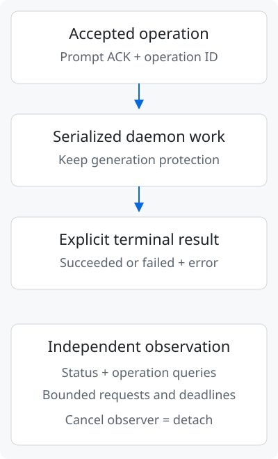
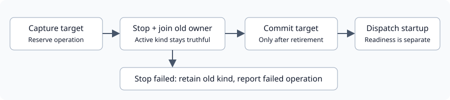
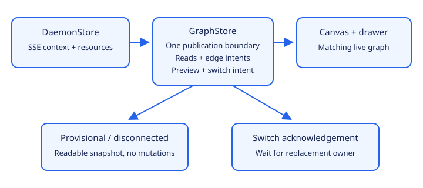
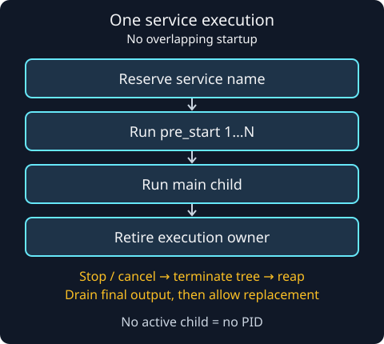

# Architecture

[English](./architecture.md) · [繁體中文](./architecture.zh-TW.md)

從 CLI 指令一路看懂 daemon、runtime 事件與 dashboard 的關係。
透過元件對照與狀態機排查服務行為，或找到擴充 Orbit 的位置。

## Overview


三個要先記在腦袋裡的概念:

1. **daemon 是大腦。** 所有 state 都由它持有。CLI 是 stateless 的 —— 透過 socket 送出 request、觀察結果，再結束。dashboard 走的是同一套 API，只是改用 TCP 加上 SSE stream。
2. **orchestrator 是 event-driven。** 單一 goroutine 從 buffered channel 消費事件(`HealthOK`、`ProcessExited`、`ContainerDrift`、…)，同步套用 state transition。container 與 dev process 共用同一套 state machine，只有 supervision 機制不同。
3. **相依關係是 DAG，不是序列。** Service 只要 `depends_on` 的目標進入 `Healthy` 就會啟動;互不相依的分支會並行跑。

剩下的章節會逐一切進每個元件。

## Component map

```
orbit up
  │
  ├─ Config Loader      internal/config/            YAML → typed schema, env-var substitution, validation
  ├─ Dependency DAG     internal/engine/            Topological sort over services + containers
  ├─ Orchestrator       internal/engine/            Event loop: translates events into state transitions
  ├─ Scheduler          internal/engine/            Decides what to start / stop / restart next
  ├─ Container Manager  internal/container/         Docker SDK wrapper (inspect, start, stop, poll, seed, init)
  ├─ Process Manager    internal/process/           Spawn / kill dev processes with group isolation
  ├─ Health Checker     internal/health/            http, tcp, log, exec, healthcheck probes + wait strategies
  ├─ Port / Preflight   internal/port/, internal/preflight/  Reserve ports, check prerequisites before launch
  ├─ Env Sync           internal/envsync/           Shallow-clone / refresh env configs from git
  └─ Daemon Server      internal/daemonsrv/         Unix socket + TCP :19800 API, Svelte 5 dashboard, SSE
```

CLI(`app` package，由各 binary 的薄 `cmd/orbit/main.go` 接線)是 daemon 的薄客戶端 —— 每個 subcommand 要嘛透過 unix socket 跟 daemon 對話，要嘛在本機跑 subprocess(docker、dotnet)。

## Service state machine

每個 service 與 container 都會走過同一組狀態。Transition 由 orchestrator event 驅動。


State 常數定義在 `internal/engine/state.go`，以 `ServiceState`(iota enum:`StatePending`、`StateBuilding`、`StateStarting`、`StateHealthy`、`StateDegraded`、`StateStopping`、`StateStopped`、`StateRestarting`)呈現。請使用這些常數 —— 純字串只會出現在 JSON 輸出。（`StateRestarting` 仍為 wire／String 相容而保留，但目前的 lifecycle 會讓 restart 直接回到 `Pending`，而不是停留在它 —— 見上方 state 圖。）

## Event loop

Orchestrator 跑一條 goroutine，從 buffered channel 消費事件。事件定義在 `internal/engine/state.go`:

| Event | 觸發時機 | 典型反應 |
|---|---|---|
| `DepsReady` | 所有宣告的 `depends_on` 目標都到達 `Healthy` | 啟動本 service |
| `HealthOK` | 上一次非 OK 之後，probe 成功 | 標記 `Healthy`;通知 dependent |
| `HealthFail` | Probe 失敗或 timeout | 標記 `Degraded`;可能觸發 restart |
| `ProcessExited` | 子 dev process 退出 | 標記 `Degraded`(非預期)或 `Stopped`(預期) |
| `ContainerDrift` | Docker poll 發現 container 實際狀態與 Orbit 認知不同 | 對齊:標記 `Degraded` 或 re-sync |
| `BuildStarted` / `BuildComplete` / `BuildFailed` | Service build 步驟(例如 `dotnet build`)生命週期 | 走過 `Building` → `Starting` |
| `Shutdown` | `orbit down` 或 signal | 沿 DAG 反向順序串聯把 service 帶到 `Stopping` |

（`EventServiceLog` 載著一行擷取到的 stdout/stderr。它走同一個 loop 派發，但不觸發任何狀態轉換 —— 它會廣播給 log 訂閱者（SSE、`orbit logs`），所以上面的轉換表沒有列它。）

排入佇列的相依就緒工作只屬於當次 pending 啟動意圖。Orchestrator 在同一個
鎖定區間內確認意圖仍有效、資源仍存在且處於 pending，以及目前相依都已就緒，
才會啟動資源。停止、移除或新的啟動意圖會讓舊工作失效，包含舊相依等待者送出的通知。

事件本身不會直接改 state —— 它們會被 dispatch 給 orchestrator，由 orchestrator 同步套用 transition。這樣 state machine 維持單執行緒，race condition 也比較好推理。

## Startup sequence


`POST /api/up` 在啟動被*派發*出去時就回應（`handlers_service.go` 呼叫 `StartServices` 後立即回），不是等全部 healthy 才回 —— CLI/dashboard 透過 SSE status 串流觀察收斂。Service 只要宣告的相依到達 `Healthy` 就會被拉起。DAG 本身不會阻塞 —— 互不相依的 service 是並行啟動的；唯一例外是未啟用 watch 的 .NET service build，它們共用一個可感知 context 的 admission gate。每個依序完成建置的 service，其 runtime process 仍會各自立即啟動。

Build 的 stdout 與 stderr 同時排空。超過 64 KiB 的診斷行會切成保留 UTF-8
字元的區塊並標示延續，未換行輸出不會無限累積。Compiler 子程序若在 build
結束後仍持有輸出 handle，最多等待兩秒排空，之後回報錯誤並釋放 admission gate。
這不是整個 build 的時間上限。

回應會列出 daemon 解析後的精確 resource 集合，包含遞迴相依與 group
篩選結果；CLI 只等待這個集合。集合為空時，`up` 是明確且成功的 no-op，
會立即返回，不會進入 health timeout。

## Lifecycle 工作與觀測



環境修改仍依序執行。另一把短暫的 snapshot lock 保護已發布的 config／runtime
視圖，不會跨越停止 resource、source refresh 等耗時工作。唯讀 status 與 SSE
因此可持續觀察進度，不必排在修改佇列後面。Epoch 與 generation 檢查仍保留，
避免排隊的工作作用到已被替換的環境。

Status、SSE 與 graph 的 mode 標示來自同一份 orchestrator kind snapshot。
已保存的 mode 設定在 runtime 視圖發布前代表意圖；磁碟保存不持有 snapshot lock。

非同步 down、指定目標的 stop 與 restart 使用有數量上限的身分與結果紀錄。完成與否取決於
operation 結果，包含 stop 與 sweep 錯誤，不依賴觀測者剛好看見中間狀態。
CLI request deadline 與取消控制的是觀測；detach 不會撤銷 daemon 已接受的工作。
同步 reconcile 與 `Down.Wait` 沿用 response 作為結果。其他 config transition
保留既有 RPC，唯讀 request 也能持續回應。

### 模式切換



模式切換沿用同一套 operation 紀錄。接受要求時固定目標模式；對外顯示的 kind
仍代表目前執行中的資源。Orbit 先停止並等待原本 owner 完成清理，再提交新模式、
派送替代資源啟動。停止失敗時保留原本 kind，並回報失敗 operation。
同一資源已有已接受或執行中的模式切換時，重疊要求回傳 `operation_busy`，
包含背景工作尚未開始的空檔；遭拒要求不會改寫已儲存的意圖。
要求目前模式仍會重新啟動。Operation 成功代表啟動已派送，健康狀態仍需另外觀察。
整體轉換的 budget 包含停止 grace、回收／輸出排空與啟動派送；
`shutdown_timeout` 仍是 owner 的停止 grace，不是所有階段共用的截止時間。

### Dashboard graph 的資料擁有權

DaemonStore 唯一擁有 SSE 環境身分與資源狀態；GraphStore 統一管理 graph 寫入、預覽、選取與切換意圖。所有 graph 回應都經過同一個接納入口，核對 daemon epoch、環境 generation 與設定路徑。



目前環境的 graph 讀取有期限，重複刷新會合併。切換 owner 會取消舊讀取，避免舊環境卡住新環境。每條 edge 保留操作順序與待確認意圖；成功回應只確認該 edge，再重新讀取 graph 更新節點資訊。讀取失敗不會抹掉已成功的寫入；等待或失敗的資料同步會顯示在畫面上。

初次載入或斷線時保留可閱讀的唯讀快照，匹配的 graph 重新讀取完成後才開放修改。同 owner 重連保留已送出 edge 寫入的順序，等候結果與資料同步；只有 runtime owner 被替換才退休舊寫入佇列。已退出的預覽不會被遲到回應重新開啟。切換 ACK 只代表 daemon 重啟已排程；畫面必須等到目標的正式 identity、不同的 daemon epoch 與匹配 graph。預覽也必須具備已連線的 daemon owner 才能啟用環境；初次載入或斷線時不能切換。重啟前先發布的目標路徑／generation 不代表切換完成。切換逾時維持唯讀，提供刷新／重新載入，並繼續觀察。

表格、節點、群組與 drawer 只有在 graph owner、資源種類、模式與節點身分一致時才投影 live 狀態。即使快速停止／啟動落在兩次相同的 SSE 之間，也會清除過時的依賴阻擋。預覽與斷線時保留快照；投影不替換 graph，也不重新排版。Runtime 更新保留結構相同的 graph 參照。Dashboard 的 edge 修改帶既有 expected epoch／generation headers，daemon 在環境切換鎖內、產生任何效果前檢查；未帶 header 的舊 client 保持原本行為。

## Container supervision vs process supervision

| | Container | Process |
|---|---|---|
| 擁有者 | `internal/container/manager.go` | `internal/process/manager.go` |
| 啟動 | Docker `container.create` + `container.start` | `exec.Command` 放在獨立的 process group(Unix 上用 `setpgid`，Windows 上用 Job Objects) |
| 停止 | Docker stop + 10 秒緩衝 → kill | 對 group 送 SIGTERM → `shutdown_timeout` 緩衝（預設 30 秒）→ 對 group 送 SIGKILL |
| Health | 每 2 秒透過 `container.inspect` polling，再加上 service 宣告的 `health_check` | 只跑宣告的 `health_check` |
| Drift 偵測 | Docker snapshot 成功後，對齊停止、移除或被外部重啟的 container | 隱式:process 死掉就會觸發 `ProcessExited` |

兩者共用同一套 state machine 與 event loop，差異完全收斂在各自 package 的 `manager.go` 內。

Docker API 連續失敗兩次後，Orbit 才會撤回先前的 healthy 判斷，避免一次短暫的
transport 抖動造成使用者可見的狀態跳動。`status` 會指出 Docker 才是根因並導向
`orbit doctor`。Orbit 會持續輪詢，Docker 恢復後自動修正 resource 狀態；使用者
不需要重啟 Orbit，也不需要逐一重啟 container。

每次 Docker 觀測 request 最多兩秒，整輪最多十秒，各輪仍依序執行。失敗或
逾時的一輪不發布不完整 snapshot，保留上一份完整觀測，直到下一輪完整成功。
連續兩輪失敗時，才啟用上述 unavailable 狀態。

## Cross-platform process groups

用 SIGTERM 殺 dev process(例如 `dotnet watch`)時，孫程序常常會殘留。Orbit 的解法是把每個 spawn 出來的 process 放進自己的 process group，然後對**整個 group** 送 signal，而不是只對 leader。

- **Unix**(Linux/macOS 上的 `internal/platform/process_unix.go`):`syscall.SysProcAttr{Setpgid: true}`，shutdown 時呼叫 `syscall.Kill(-pgid, sig)`。
- **Windows**：Child 先暫停建立，加入 Job Object、記錄 ownership 後才開始執行。
  停止時保留 Job，最多兩秒查詢其 active-process accounting，確認清退。
  查詢失敗或逾時會保留同一 Job 與 child 身分，供明確呼叫 `Stop` 重試。
  外部 process reference 可能延後清退確認。Daemon 結束時，關閉 Job 也會終止其後代。

結果是:`orbit down` 能可靠地回收整棵 process tree —— 不管是 shell、reload 中的 `dotnet watch` server,還是 `pnpm dev` 的 Vite instance —— 而不是只對 leader 送 signal、留下孫程序。

Lifecycle 取消與明確的 stop 共用同一套 process group 終止流程。Restart 會等到
那一代 process 確實結束、manager 紀錄移除後，才開始追蹤替代的 process；被取代
那一代較晚送來的 exit 或 health 事件會被忽略。

Unix 的 context 取消也使用同一個 owner 與設定的 grace，讓會處理 shutdown signal 的
host process 能完成清理。即使啟動途中收到取消，也會先安裝 reader 與 wait／reaping
owner，確保能回收與回報。

| 等待項目 | 起點 | Budget 與結果 |
|---|---|---|
| Group 終止 | Lifecycle 取消、明確 stop，或 leader 退出 | 既有設定的 grace，之後沿用平台的升級終止政策 |
| 最後輸出 | Leader 已 reaped，且 group 終止已返回結果 | 最多兩秒等待 stdout／stderr EOF |

Leader 自然退出時，若 group 終止尚未開始，manager 會透過同一 owner 啟動既有 grace 與升級終止流程，清理仍存活的 owned group；已開始則等待它返回。
Readers 在設定的 group grace 期間保持開啟；leader 已 reaped 且 group 終止返回後，
才開始最後輸出窗口。若 inherited handles 超過輸出窗口仍未
關閉，Orbit 會關閉自己的 readers，回報 `ErrOutputDrainTimeout`（尾端輸出可能
不完整）。終止與排空都返回結果後，才回報主 child 的 exit。
Tree 終止成功才移除 ownership；終止失敗會保留 child 身分與 reservation，
阻擋替代啟動，直到明確呼叫 `Stop` 重試。重試成功會釋放已清退的 owner，
但仍回報先前的輸出排空逾時。
輸出窗口與 grace 分開計算，不是整個 shutdown 的兩秒上限。Output callback
仍需遵守原有的快速返回要求。



Process manager 在第一個 `pre_start` 之前保留 service 名稱。每個準備或主
child 分別管理自己的 process tree、reaping 與最後輸出排空；整段 execution
統一管理取消，禁止啟動重疊。`Stop` 與 `StopAll` 會取消並等待完整 execution，
包括準備指令之間尚無 child 的階段。沒有 active child 的 reservation 不回報 PID。
`OnStarted` 與帶 generation 的 `OnExit` 仍只代表主 child。獨立 ownership 通知
會持久化 active child 原始、未展開的指令、目錄、stage 與 PID/PGID，不會把
準備 PID 記成主指令。Recovery 沿用既有清退流程，將任一 stage 結束並標成
stopped，重新啟動時再從頭執行準備指令。持久化仍為 best effort，並非涵蓋
process 建立與磁碟寫入的 transaction。

Process 的 PID/PGID ownership 在註冊後立刻持久化，早於回報 health。Daemon
異常結束後，Orbit 會在正常啟動建立新 child 之前，安全地結束仍存活的已持久化
process；若直接接管它，輸出 pipe 仍接在已死的 daemon 上，可能誤報恢復。已死的
持久化 PID 會成為一般的 stopped service。Container 帶有 namespace、service 與
config-fingerprint label，因此新 daemon 能接管完全相符的執行中 container，或
安全替換過時、由 Orbit 擁有的 container。只有 Orbit 無法證明是自己擁有的
resource，才會回報為外部 port 衝突。

## Health check types

`internal/health/checker.go` 實作了五種 probe:

| Type | 用途 | 節奏 |
|---|---|---|
| `http` | HTTP endpoint 回傳 2xx；明文 probe 依 service generation 與 origin 探測 h2c 或 HTTP/1.1 | 每 `health_check_interval` poll 一次，啟動期間漸增到此值（[configuration](configuration.zh-TW.md#settings)） |
| `tcp` | TCP port 接受連線 | Polled，啟動期間與 `http` 一樣漸增 |
| `exec` | 在 container 裡跑一個 command;exit 0 視為 healthy | Polled |
| `log` | 對 container log 做 regex 比對 | 由 log tail 觸發 |
| `healthcheck` | 直接用 Docker 自己的 `HEALTHCHECK` 結果 | 透過 inspect polling |

Probe 在 per-service 的 goroutine 跑，context 會在 stop 時被 cancel —— 參考 `internal/health/checker.go` 與 `internal/health/` 底下的測試(例如 `checker_test.go`、`recover_test.go`)看完整契約。

明文 HTTP 協定探測會先嘗試 h2c，再嘗試 HTTP/1.1，並快取第一個回傳有效
response 的協定。有效的 non-2xx 是 unhealthy 結果，不是 fallback 訊號。
Redirect target 依 origin 分別探測；service 停止時，generation-scoped probe
session 會丟棄所有協定選擇。

啟動完成後，可重複的 probe（`http`、`tcp`、`exec` 與 Docker
`healthcheck`）都會持續執行。可設定的連續失敗門檻避免單次暫時性失敗讓
graph 反覆變色；一次成功即可讓 degraded 資源恢復。`log` 仍是一次性的
readiness 訊號，因為過去曾出現的 log 無法做有意義的反向探測。

Status 組裝會疊加依賴可用性，但不改寫 lifecycle state。若仍在執行的 healthy
process 依賴 stopped 或 degraded 資源，API view 會以 degraded 和
`blocked_by` 呈現，並保留可追查的直接依賴鏈。根因依賴恢復後，這層狀態會
自動消失，仍在執行的下游不需 restart 就能恢復。

## Daemon server

`internal/daemonsrv/server.go` 就是那個單一長駐 process，它對外暴露:

- **Unix socket**（`~/.orbit/orbit.sock`）—— CLI ↔ daemon 的 HTTP（REST `/api/...`），走 unix socket
- **Loopback TCP :19800** —— 同一套 HTTP API，加上 Svelte 5 dashboard（透過
  `go:embed` 內嵌）與 SSE stream。Browser-facing control surface 會驗證
  loopback Host，且 mutation 必須是 same-origin。

Unnamed runtime 會維持這些舊有 paths 與 names。Named runtime 的 ownership、
state layout、port persistence 與 cleanup semantics 定義於
[隔離的 runtime instances](instances.zh-TW.md)。

所有 HTTP handler 依關注點分散在 `internal/daemonsrv/*.go`:

| File | 負責 |
|---|---|
| `server.go` | Router、middleware |
| `handlers_service.go` | up/down/stop/restart/logs |
| `handlers_service_env.go` | 個別 service 的 env var override |
| `handlers_mode.go` | 個別 service 的 dev ↔ container mode 切換 |
| `handlers_logging.go` | SSE log tail |
| `handlers_env_toggles.go` | 各 env 的 feature toggle |
| `handlers_events.go` | SSE status event stream |
| `handlers_traces.go` | Trace 列表 / 詳情與 OTLP log record([tracing.zh-TW.md](tracing.zh-TW.md)) |
| `handlers_graph.go` | 相依 DAG 查詢 |
| `handlers_history.go` | 過去執行紀錄 |
| `handlers_settings.go` | User settings(workspace root) |
| `resource_snapshot.go` | `GET /api/resources` — 統一、唯讀的 resource snapshot |
| `envs.go` / `envs_dir.go` | Env 列表 / 當前 env |
| `doctor.go` | Health 診斷 |

Daemon 持有所有共享 state。CLI 指令是 stateless 的 —— 透過 socket 送出 request、觀察結果，再結束。

### Resource snapshot 契約

`GET /api/resources` 用同一個 display-oriented shape
`{schema_version, env, resources}` 呈現 containers、services、externals、
databases、tunnels 與 claimed routes。每個 resource 都有 `name`、開放集合的
`type` 與 `state`、選配的 `parent` 與 `depends_on`，以及扁平的字串
`properties`。

這份契約只做 additive change；只有移除或改名才增加 `schema_version`。
Consumer 必須能通用呈現未知的 resource type、state、field 與 property。
`parent` 表示 ownership，`depends_on` 表示啟動圖；排序固定，parent 在 child
之前。

Snapshot 不取代 domain-specific API。Streams、graph presentation、actions
與跨機器 tunnel claims 仍由各自 endpoint 負責。

## Extension points

常見改動與對應位置。Optional feature 透過 `extension` package 接上 commands、
daemon routes 與 dashboard panels；以下各點適用於 core 本身的變更。

### 新增一種 service `type`
1. 在 `internal/config/schema.go` 擴充 `Service.Type` discriminator。
2. 在 `internal/engine/scheduler.go` 加上能拉起這個 type 的 launcher。
3. 如果 health check 邏輯不同，在 `internal/health/checker.go` 加一個 probe type。
4. 在 `envs/example.yaml` 補上參考設定。

### 新增一種 health check type
1. 在 `internal/health/checker.go`(`checker.probe()`)裡加一個 case。
2. 在 `docs/configuration.md` 文件化對應的 YAML 形狀。

### 新增一種 init hook
目前的 type:`kafka_topics`、`mongo_rs`。要新增一種:
1. 在 `internal/container/init.go` 加一個 case。
2. 在 `internal/config/schema.go` container 的 `init` block 底下定義對應 config struct。

### 新增一個 CLI subcommand
1. 在 `internal/app/` 底下新增檔案，由 `fooCmd()` factory 回傳 `*cobra.Command`。
2. 在 `internal/app/root.go` 的 `Main()` 註冊。
3. 如果它要跟 daemon 對話，在 `internal/daemonsrv/*.go` 加對應 handler，再從 command 呼叫:payload 是 wire 型別就加 `daemon.Client` method(`internal/daemon` package);payload 用到 core-internal 型別，就在 command 旁邊用 `Client.GetDecode`/`PostJSON` 寫 unexported helper(見 `internal/app/traces.go`、`internal/app/history.go`)。

### 隨 binary 一起出貨新的 asset
用 `//go:embed` 內嵌，不要依賴 on-disk 路徑 —— 安裝好的 binary 旁邊不會有 source tree。Dashboard bundle 可參考 `cmd/orbit/dashboard.go`(在 binary 的 main package 內嵌後注入 daemon server;branded binary 也以相同方式內嵌自己的 dashboard build)。

## 延伸閱讀

- [docs/configuration.zh-TW.md](configuration.zh-TW.md) —— 完整 YAML schema 參考
- [docs/tracing.zh-TW.md](tracing.zh-TW.md) —— local OpenTelemetry workflow

## BigQuery

[BigQuery 開發與整合測試](./bigquery.zh-TW.md) 說明選用環境設定、CLI prepare/inspect/list/clean、ADC 身分、只讀 dashboard，以及離線證據與真實 GCP E2E 的差異。`orbit bq` 使用標準 `orbit.cli.v1` JSON envelope；sandbox inspect/list 不連雲端。明確 clean 需 `--yes --app-stopped --restricted-writers`，停止環境不會刪除 dataset。
