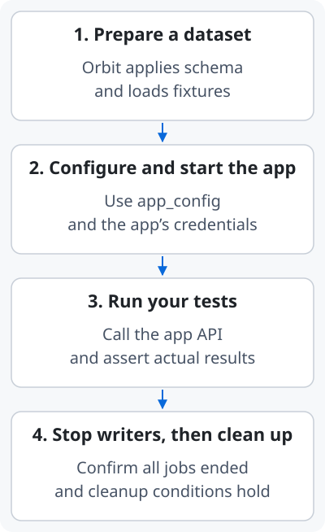

# BigQuery

[English](./bigquery.md) · [繁體中文](./bigquery.zh-TW.md)

Use Orbit to inspect a shared BigQuery dataset or prepare an isolated dataset
with fixtures for backend tests. Your application connects directly to BigQuery.
Orbit manages the test data; your test harness starts the app and checks results.



Preparation makes test data ready. It does not prove that your app can access
BigQuery or that its queries are correct.

<a id="credentials-and-permissions"></a>

## Before you start

- Use **Orbit v1.2.0 or later** and a dedicated GCP development/test project.
- Configure Application Default Credentials (ADC) for the CLI and credentials
  for your app. See [credentials and permissions](./bigquery-testing.md#credentials-and-permissions).
- Copy the [example YAML, schema and fixture](https://github.com/iml885203/orbit/tree/main/docs/examples/bigquery)
  together into your project. Replace the project IDs and choose the location.

Without a GCP project, you can still develop and run offline tests. See
[testing strategy](./bigquery-testing.md#testing-strategy-and-opt-in-cloud-smoke).
Orbit does not provide a local BigQuery emulator.

## Enable one environment

Add the optional `bigquery:` section from the example to your selected
environment's `version: "3"` YAML. Keep the YAML, schema and fixtures in Git.
Upgrade the team's CLI and CI before merging it: older Orbit binaries reject
this section even though the shared format remains v3. Field details live in the
[configuration reference](./configuration.md#bigquery).

No `bigquery:` section means no BQ credential requirement. The dashboard displays
local configuration and records; it does not check cloud access. `orbit up`
does not prepare datasets.

## Prepare, run the app, dispose

The commands below use the repository example. If you copied it, replace
`--config` with your YAML path. Use `--instance` when targeting a named instance.
Keep the same config, instance, profile and run key throughout the operation.

### 1. Inspect a shared dataset, if you use one

```sh
orbit --config docs/examples/bigquery/orbit.yaml bq inspect shared --json
```

This reads cloud metadata and checks the location. It does not run SQL.
Skip this step if you only use the disposable `integration` profile.

### 2. Prepare isolated test data

Before prepare starts, register a `finally`/CI `always` teardown in your test
harness. It must stop any app it starts, preserve evidence on failure, and
attempt authorized cleanup only when the conditions in step 4 hold.

```sh
orbit --config docs/examples/bigquery/orbit.yaml bq sandbox prepare integration --run test-001 --timeout 2m --json
```

On success, check `data.sandbox_data_ready`. Read `data.app_config` using a JSON
parser; it contains explicit targets such as `ORDERS_DATASET`. Pending or unknown
results are not ready. After interruption, retry the same run key; do not change
fixtures or start a new run to hide unfinished resources.

### 3. Configure and test your app

Supply `data.app_config` through your app's normal configuration mechanism,
then start it with its own credentials. Orbit does not inject settings into a
running app. Do not `eval` JSON output as shell text.

Call the app's actual API and check its results. With the example fixture, an
assertion could verify customer totals A=300 and B=50. Orbit keeps
`app_runtime: unverified`; a successful seed is not an E2E pass.

### 4. Stop writers and clean up

Stop the app, wait for **all app and external jobs** to finish, and ensure no
other writer can replace this dataset or reuse its name. Only then authorize
recursive deletion:

```sh
orbit --config docs/examples/bigquery/orbit.yaml bq sandbox clean integration \
  --run test-001 --yes --app-stopped --restricted-writers --json
```

The flags state operational conditions; they do not enforce IAM or lock out
other writers. If you cannot establish these conditions or cleanup is refused,
[preserve the record and follow recovery](./bigquery-testing.md#recovery-and-manual-disposition).
`down`, switching environments and `instance clean` do not delete cloud datasets.
Table expiration is not dataset cleanup or a billing cap.

## Recovery and manual disposition

Use `orbit bq sandbox inspect` or `list` to read local records without GCP access.
They report recorded evidence, not current cloud state. For interrupted runs,
unknown jobs or blocked deletion, use [testing and recovery](./bigquery-testing.md#recovery-and-manual-disposition).

## Testing strategy and opt-in cloud smoke

See [testing and recovery](./bigquery-testing.md#testing-strategy-and-opt-in-cloud-smoke)
for backend unit tests, offline SDK tests and opt-in real-project validation.
No real GCP project was used for this implementation's offline tests; IAM/WIF,
GoogleSQL and app E2E remain unverified until you run that validation.
