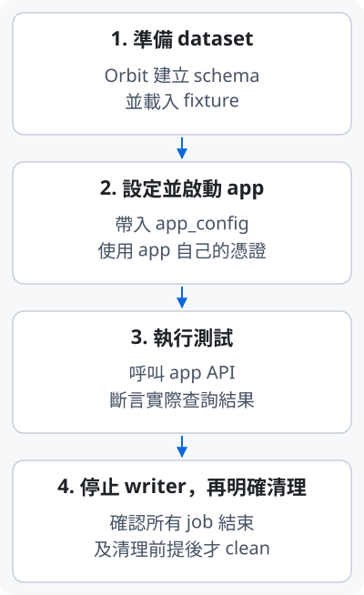

# BigQuery

[English](./bigquery.md) · [繁體中文](./bigquery.zh-TW.md)

用 Orbit 檢查共用的 BigQuery dataset，或替後端測試準備含有範例資料的隔離 dataset。
應用程式直接連 BigQuery；Orbit 管理測試資料，測試程式負責啟動 app 和驗證結果。



準備成功代表測試資料就緒；app 是否有權限、SQL 是否正確，仍由你的測試確認。

<a id="認證與權限"></a>

## 開始前

- 使用 **Orbit v1.2.0 以上**，準備專用的 GCP 開發／測試 project。
- 設定 CLI 的 Application Default Credentials（ADC，應用程式預設憑證），以及 app
  自己的憑證。見[認證與權限](./bigquery-testing.zh-TW.md#認證與權限)。
- 將[範例 YAML、schema 與 fixture](https://github.com/iml885203/orbit/tree/main/docs/examples/bigquery)
  一起複製到專案，替換 project ID 並選定 location。

沒有 GCP project 時，仍可開發和執行離線測試，見[測試策略](./bigquery-testing.zh-TW.md#測試策略與選用-live-smoke)。
Orbit 不提供本地 BigQuery emulator。

## 啟用與 YAML 相容性

在選定環境的 `version: "3"` YAML 加上範例中的選用 `bigquery:`，將 YAML、schema
和 fixture 一起放進 Git。先升級團隊與 CI 再合併設定：格式雖維持 v3，舊版 Orbit
仍會拒絕這個 section。欄位說明見[設定參考](./configuration.zh-TW.md#bigquery)。

沒有 `bigquery:` 就不要求 BQ 憑證。Dashboard 只顯示本地設定與紀錄，不檢查雲端
連線；`orbit up` 不會自動準備 dataset。

## 準備、啟動 app、清理

以下使用 repo 內的範例；複製到自己的專案後，請將 `--config` 改成你的 YAML 路徑。
操作 named instance 時加上 `--instance`。整個流程使用相同的 config、instance、
profile 與 run key。

### 1. 如果有共用 dataset，先檢查

```sh
orbit --config docs/examples/bigquery/orbit.yaml bq inspect shared --json
```

此指令讀取雲端 metadata 並檢查 location，不執行 SQL。只用可拋棄的 `integration`
profile 時，可略過這一步。

### 2. 準備隔離測試資料

在 prepare 開始前，於測試程式註冊 `finally`／CI `always` teardown：停止自己啟動的
app，失敗時保留證據，且僅在步驟 4 的條件成立時嘗試已授權的清理。

```sh
orbit --config docs/examples/bigquery/orbit.yaml bq sandbox prepare integration --run test-001 --timeout 2m --json
```

成功後確認 `data.sandbox_data_ready`，用 JSON parser 讀取 `data.app_config`，取得
`ORDERS_DATASET` 等明確目標。Pending／unknown 不算就緒。中斷後用相同 run key
重試；不要改 fixture 或另開 run 隱藏未處置的資源。

### 3. 設定並測試 app

透過 app 原本的設定機制帶入 `data.app_config`，以 app 自己的憑證啟動。
Orbit 不會自動注入正在執行的 app，也不要用 `eval` 把 JSON 當 shell 指令執行。

呼叫 app 的實際 API 並斷言結果。範例資料可驗證客戶總額 A=300、B=50。
Orbit 的 `app_runtime` 維持 `unverified`；seed 成功不等於 E2E 通過。

### 4. 停止寫入並清理

停止 app，等待**所有 app 與外部 job**結束，確認沒有其他 writer 能替換 dataset
或重用名稱，才明確授權遞迴刪除：

```sh
orbit --config docs/examples/bigquery/orbit.yaml bq sandbox clean integration \
  --run test-001 --yes --app-stopped --restricted-writers --json
```

這些 flag 是營運條件的聲明，不會強制 IAM 或鎖住其他 writer。條件無法確認，或
清理遭拒時，[保留紀錄並走復原流程](./bigquery-testing.zh-TW.md#復原與人工處置)。
`down`、切換環境與 `instance clean` 不會刪除雲端 dataset。
Table expiration 不等於 dataset 清理或費用上限。

## 復原與人工處置

用 `orbit bq sandbox inspect` 或 `list` 讀取本地紀錄，不需連 GCP。紀錄不是即時
雲端狀態。中斷、job 不明或清理遭拒時，見[測試與復原](./bigquery-testing.zh-TW.md#復原與人工處置)。

## 測試策略與選用 live smoke

後端 unit test、離線 SDK 測試與選用的真實 project 驗證，見[測試與復原](./bigquery-testing.zh-TW.md#測試策略與選用-live-smoke)。
本功能的離線測試未使用真實 GCP project；IAM／WIF、GoogleSQL 與 app E2E 仍需
實際執行該驗證後才能確認。
