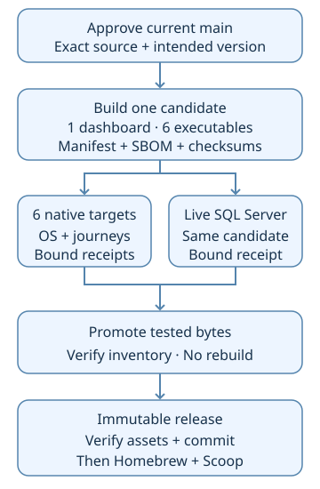
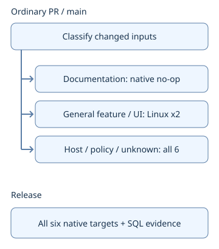

# Verify and resume a delivery

[English](./delivery.md) · [繁體中文](./delivery.zh-TW.md)

Check which source and bytes were tested before merging or resuming a release.
The result is a local checkpoint of live GitHub evidence, not permission to skip
review, CI or the existing release approval.

```bash
python3 scripts/delivery_status.py --pr 123 --workspace /path/to/task --json
```

Use your allocated task workspace. After dispatching a release, add its exact
`--release-run` ID and `--tag` to the same command. Repeat those selectors when
resuming; the tool never guesses a publication from a nearby run. Use `--help`
for options. Human output summarizes progress; JSON retains individual jobs,
attempts, timings and candidate digests.

Artifact metadata reads use the exact selected ID, with at most three GETs.
Each request has a 10-second limit; retries wait 0.5 then 1 second, only for
404, HTTP 500/502/503/504, or a request timeout. A 404 can also hide an inaccessible resource; it is
not proof that metadata will become available. Explicit 401/403, rate limits,
malformed replies and identity/digest/expiry mismatches fail closed. Timeouts share the same three-attempt budget; it does not restart.
These are bounded reads, never replacement uploads or
publication retries, and the same policy applies to the delivery observer.



## What the workflow proves

The candidate producer builds one dashboard and six product executables. Its
manifest binds the source SHA, intended version, tools, inputs, run and producer
attempt to exact file digests. The uploaded artifact ID and archive digest are
paired with that manifest in a small identity artifact.

Native runners verify and execute those bytes. They retain source compilation
and OS tests, plus installer fixtures, uninstall and automatic-update scenarios.
All Unix targets exercise the .NET journey. SQL Server readiness uses the same
Linux candidate; its publish-engine tests still use a real SQL Server. Each
successful consumer records evidence bound to the artifact and binary digest.

Promotion requires all six native receipts and SQL evidence. It copies the
already tested inventory, then preserves checksum, SBOM, provenance and
immutable-release verification. It does not rebuild the dashboard or product
executables. The published eight-file inventory stays unchanged. Source-test
compilation and installer fixture builds are separate from candidate builds.

## Choose ordinary CI coverage

PR and main CI keep the complete Linux preflight, lint, supply-chain and user /
.NET journeys. Native validation follows the changed inputs:

- Known documentation: an explicit native no-op.
- Recognized general features and UI: Linux amd64 and arm64.
- Host lifecycle, CLI/daemon/platform, installer/update, build/dependencies,
  CI/policy, unknown inputs or missing diff evidence: all six platforms.



The [classifier](https://github.com/iml885203/orbit/blob/main/scripts/native_impact.py) owns the recognized input policy.
It checks both sides of a diff, including Go build constraints in generic
filenames. Invalid evidence fails; it cannot produce a successful no-op.
The native gate verifies exact selected-target receipts against the candidate,
not just the reusable workflow's aggregate result. The six-executable candidate
inventory stays unchanged even for Linux validation.

The observer reports `native_coverage` with the selected profile, targets,
reason and actual jobs. An intentional Linux pass establishes that coverage;
it is not six-platform compatibility. Older full-matrix runs remain observable
with their legacy evidence labelled. A missing partial-matrix plan, unexpected
skip or foreign/stale receipt cannot pass.

For a deliberate diagnostic, manually run **Platform smoke** with `profile`
set to `linux` or `full` (the default). Diagnostic dispatch is separate from
canonical PR/main CI and cannot satisfy publication's current-main check.
Release always selects full coverage and promotion still requires six native
receipts plus SQL evidence. Publication checks the latest canonical main CI and
actual required jobs; release authority never comes from a reduced PR pass.

PR artifacts are diagnostic. Only a separately approved, current-main release
workflow can promote its own candidate. PR jobs have read-only repository
permissions and no release signing authority. Repository branch-protection
settings are separate; this change enforces workflow and publication gates.

## Recover without repeating accepted actions

Run the observer after a state change, timeout or agent restart. It reads live
PR, issue, job, candidate, release and package-channel state before replacing
its checkpoint. Inspect failed or pending jobs before deciding the next step.
An inspection that exits successfully means evidence was read; it does not
mean every delivery gate passed.

A failed-job-only rerun may retain successful jobs from an earlier attempt of
the **same run and source**. The observer uses each job's newest result. A newer
failure or skip cannot be hidden by an older success. A changed PR head drops
old reported review evidence. Agent review notes remain labelled as reported,
separate from GitHub's review decision.

If publication already exists, verify that its immutable assets and commit
match the candidate. Resume unfinished verification or package updates. Never
create a replacement release or rebuild different bytes under that tag. The
promotion job reconciles an already accepted matching publication before a
retry, so a lost response does not trigger another create request.

API failures stop observation without turning the old checkpoint into fresh
success. Expired or missing candidate artifacts are incomplete evidence. A
newly built candidate needs its own checks; it cannot inherit another
candidate's receipts. The observer reads the small identity artifact rather
than downloading all executables on every inspection. Binary verification
remains the native and promotion jobs' responsibility.

The checkpoint stores selected evidence, not tokens, signed archive URLs or
private project configuration. Keep it in task storage and release that storage
when the task ends. Save any required long-term report before cleanup; Actions
candidate artifacts have a limited retention period.

### Resume a package updater

If a package updater was accepted but its parent failed to observe it, run the
standalone sync workflow with that exact downstream run ID. For example:

```bash
gh workflow run sync-scoop.yml --ref main -f version=v1.5.0 -f existing_run_id=44671384322
```

Use `sync-homebrew.yml` for Homebrew. This starts verification in Orbit without
dispatching another package update. It verifies the immutable published release,
then checks the selected run belongs to the package repository's `update.yml`
workflow, on `main`, dispatched for Orbit and the exact version. The run must
succeed, and the current package manifest must still reference that release.
A mismatched run or manifest fails; a newer package version is not rolled back.
The historical parent run keeps its original result.

Both new dispatches and explicit recovery observe the exact accepted run URL.
Dispatch, discovery and observation share a 10-minute total budget, leaving
time for the workflow’s other checks. Each observation allows up to 60 reads,
with a 10-second request limit and 5 seconds between unfinished or transient
reads. Only 404, HTTP
500/502/503/504 and request timeouts are retried; 404 does not establish why a
run was unreadable. Explicit authorization errors, rate limits, malformed data
and identity mismatches fail immediately. Unsuccessful terminal results and an
exhausted budget fail visibly. Discovery has a separate bounded budget; neither
path retries dispatch. After a lost dispatch response, inspect accepted work
before choosing an existing run ID; do not blindly repeat the update.
