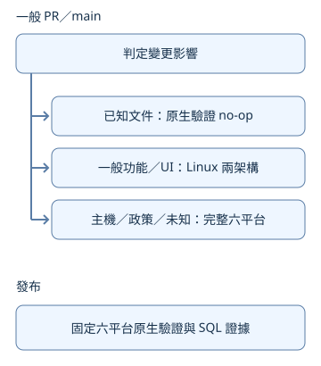
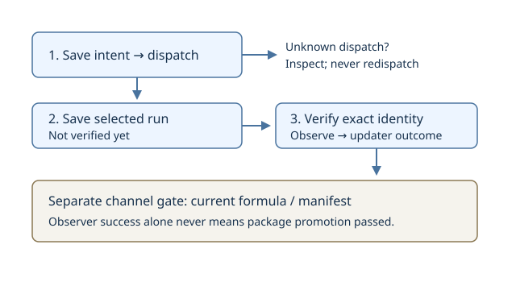

# 確認交付進度並接續工作

[English](./delivery.md) · [繁體中文](./delivery.zh-TW.md)

合併或接續發布前，先確認哪份來源與 binary 通過了哪些測試。
工具會把 GitHub 的即時證據存成本機 checkpoint；它不會取代 review、CI 或
既有的 release approval。

```bash
python3 scripts/delivery_status.py --pr 123 --workspace /path/to/task --json
```

使用已分配的 task workspace。啟動 release workflow 後，在同一條指令加上
精確的 `--release-run` ID 與 `--tag`。接續時再次提供相同 selectors，工具不會
用附近另一個 run 猜測發布結果。參數請見 `--help`。一般輸出摘要進度，JSON
保留各 job、attempt、耗時與候選檔案 digest。

Artifact metadata 只查指定的同一個 ID，最多三次 GET；每次最多 10 秒，
只有 404、HTTP 500/502/503/504 或 request timeout 會等待 0.5 秒、1 秒後重試。404 也可能
表示無權存取，不能當成 metadata 稍後一定出現的證據。明確的 401/403、rate limit、
格式錯誤及身分／digest／expiry 不符都直接失敗。Timeout 共用原本最多三次的
額度，不會重新計次。
這項有界讀取政策也用於 delivery observer，不會重新上傳或重送 publication。


## 流程驗證什麼

Producer 建立一次 dashboard 與六個產品 executable。Manifest 將來源 SHA、
預計版本、工具、輸入、run 與 producer attempt 綁定到各檔案 digest。
上傳後的 artifact ID、archive digest 與 manifest 另存成小型 identity artifact。

Native runners 驗證並執行這些 bytes，保留 source compilation、OS 測試、
installer fixtures、uninstall 與自動更新情境。所有 Unix targets 都執行 .NET
journey。SQL Server readiness 使用同一份 Linux candidate，publish engine
仍對真實 SQL Server 測試。成功後的 receipt 會綁定 artifact 與 binary digest。

Promotion 需要六個 native receipts 與 SQL 證據，直接複製測過的產物，保留
checksum、SBOM、provenance 與 immutable-release 驗證，不重建 dashboard
或產品 executable。正式發布仍是原本八個檔案。Source tests 的編譯與
installer 測試用的 fixture builds 另外計算。

## 一般 CI 的驗證範圍

PR 與 main 都保留完整 Linux preflight、lint、供應鏈與使用者／.NET 流程檢查。原生驗證依變更選擇：

- 已知文件：明確的原生驗證 no-op。
- 已識別的一般功能與 UI：Linux amd64、arm64。
- 主機生命週期、CLI／daemon／platform、安裝／更新、建置／依賴、CI／政策、未知輸入或缺少可靠 diff：完整六平台。



[Classifier](https://github.com/iml885203/orbit/blob/main/scripts/native_impact.py) 是已識別路徑政策的唯一來源，會檢查 diff 兩側，包括一般檔名內的 Go build constraints。無效證據會失敗，不能產生成功的 no-op。Native gate 會核對選定平台的 receipts 與同一份 candidate，不只看 workflow aggregate success。即使只選 Linux，candidate 仍包含原本六個 executable。

Observer 的 `native_coverage` 會列出 profile、targets、原因與實際 jobs。Linux 通過只代表該範圍，不代表完整六平台相容。舊的完整矩陣仍可檢查，並標示 legacy 證據；部分矩陣缺少計畫、非預期 skip 或不符／過期 receipt 都不能通過。

若要明確診斷，可手動執行 **Platform smoke**，選擇 `linux` 或預設的 `full`。這類 dispatch 與正式 PR／main CI 分開，不能滿足發布的 current-main 檢查。發布固定選 full，promotion 仍需六份原生 receipts 與 SQL 證據；不會把簡化 PR 驗證當作發布權威。

PR 產物用於診斷。只有另行核准、來源仍為 current main 的 release workflow
能提升自己建立的 candidate。PR jobs 只有 repository read 權限，沒有 release
簽章權限。Branch protection 設定是另一層政策；這次強制的是 workflow 與
發布門檻。

## 接續時不重做已接受的動作

狀態改變、逾時或 agent 重啟後，再執行 observer。它會重新讀取 PR、issue、
job、candidate、release 與套件渠道的即時狀態，再更新 checkpoint。先看清楚
失敗或等待中的 job，再決定下一步。工具成功結束代表取得證據，不代表整個
交付已經通過。

只重跑失敗 job 時，可保留**相同 run 與來源**較早 attempt 的成功結果；
observer 取每個 job 最新的結果，新 failure 或 skip 不能被舊 success 蓋掉。
PR head 改變時，舊的 review 紀錄會失效。Agent 的 review notes 明確標為
reported，與 GitHub review decision 分開。

若發布已存在，先驗證 immutable assets 與 commit 確實對應 candidate，再
接續尚未完成的驗證或套件更新。不要重建另一份 bytes 或替換同一個 tag。
Promotion retry 會先確認已接受的相同發布，避免遺失回應後再次送出 create。

API 失敗會停止觀測，不把舊 checkpoint 當成新的成功。過期或缺少 artifact
代表證據不完整；重建的 candidate 必須重跑自己的 checks，不能沿用另一份
產物的 receipts。Observer 只讀小型 identity artifact，不在每次檢查下載全部
executable；binary 驗證仍由 native 與 promotion jobs 執行。

Checkpoint 只保留選定證據，不儲存 token、簽名 archive URL 或私人專案設定。
放在 task storage，工作完成後依儲存政策釋放；若需要長期報告，先另存成果。
Actions candidate artifacts 有保存期限。

### 接續套件 updater

套件 updater 已接受、但 parent 無法觀測結果時，以確切 downstream run ID
執行獨立 sync workflow。例如：

```bash
gh workflow run sync-scoop.yml --ref main -f version=v1.5.0 -f existing_run_id=44671384322
```

Homebrew 使用 `sync-homebrew.yml`。這會在 Orbit 啟動驗證，不會再次派送套件
更新。先驗證已發布的 immutable release，再核對所選 run 屬於套件 repository
的 `update.yml`、來源為 `main`、以 workflow dispatch 更新 Orbit 的指定版本。
該 run 必須成功，目前套件 manifest 也必須仍引用該 release。不符的 run 或
manifest 會失敗；不會把較新套件降版。歷史 parent run 保留原本結果。

新派送與明確 recovery 都觀測確切的 accepted run URL。Dispatch、discovery
與觀測共用 10 分鐘總預算，保留 workflow 其他檢查所需時間。每次觀測最多讀取
60 次，每次 request 最多 10 秒，未完成或暫時讀取失敗時相隔 5 秒。只重試
404、HTTP 500/502/503/504 與 request timeout；404 不代表已知無法讀取的原因。
明確授權錯誤、rate limit、格式錯誤與 identity 不符立即失敗；未成功的終止
結果與耗盡次數也會明確失敗。Discovery 有獨立的有限次數；兩條路徑都不會
重試 dispatch。若 dispatch 回應遺失，先檢查已接受的工作，再選 existing run
ID；不要直接重做更新。

### 保留套件觀測結果

Homebrew 與 Scoop jobs 會保留七天的 observer artifact，名稱為
`package-observation-<channel>-<Orbit run ID>-<attempt>`。它記錄選了哪個 updater，
以及觀測成功或停止的原因。`success` 只代表 **updater 成功**；immutable release
及目前 formula／manifest 仍各有獨立 gate。若前置 gate 在 observer 啟動前失敗，
可能沒有結果 artifact。



本機觀測可選擇設定 `SYNC_RESULT_PATH`，指向已配置 task storage 裡的檔案。
未設定時保留既有 logs 與 exit 行為。Composite action 的可選 `result_path`
會提供這個環境變數。只上傳 JSON；旁邊的 lock 與暫存檔不會上傳。

若要接續保留的結果，從 **確切** Orbit run 下載 **確切名稱** 的 artifact 到已配置
的 task workspace。使用包含此 helper 的 checkout：

```bash
gh run download ORBIT_RUN_ID --repo iml885203/orbit \
  --name package-observation-scoop-ORBIT_RUN_ID-ATTEMPT --dir /path/to/task/restored
REPOSITORY=iml885203/scoop-bucket VERSION=v1.5.1 \
  SYNC_RESULT_PATH=/path/to/task/restored/package-observation-scoop.json \
  .github/actions/sync-package-repository/sync.sh
```

先讓 `gh` 取得套件 repository 權限，例如在環境中設定 `GH_TOKEN`。不要把憑證
放進 JSON。下載不會自動接續 job；上述明確的本機執行會驗證檔案，再遠端核對
所選 run，不會派送或搜尋另一個 run。即使目前 Orbit run／attempt 不同，也會
保留原派送 correlation 及完整 title 核對。檔案中的 `identity_verified` 不能
替代新一次核對。

若派送可能已接受、但尚未選到 run ID，helper 會拒絕再次派送。先檢查已接受的
工作，再設定 `EXISTING_RUN_ID` 接續確切 updater；衝突 ID 在網路呼叫前即失敗。
前述 hosted workflow 的 `existing_run_id` recovery 不需要 artifact，保存期限
過後仍可使用。Artifact 不代表跨 job 自動 restore。

#### 維護者結果契約

`docs/delivery.md` 擁有 `orbit.package-observation.v1`。此維護者 schema 與
`orbit.cli.v1` 獨立，不能授權 release 或套件 promotion。

| 欄位 | 意義 |
| --- | --- |
| `schema`, `repository`, `version` | Schema 名稱與確切套件／release |
| `producer` | 原派送 `run_id`、`attempt`（以連字號組合成 correlation）；直接 existing-run recovery 為 null |
| `state`, `reason_code` | 目前觀測階段與下列穩定原因 |
| `dispatch_acknowledged` | 派送回覆成功，不代表 updater 身份已核對 |
| `selected_run` | 正整數十進位 `id` 與本機建立的 canonical `url`，或 null |
| `identity_verified` | 目前階段通過身份核對；restore 不會信任此值 |
| `observation` | Allowlist 中的 updater `status`／`conclusion`，或 null |
| `mismatches` | 欄位名稱、預期規則代號與安全觀測標記 |
| `started_at`, `observed_at` | UTC 時間；restore 保留原起始時間 |
| `recovery` | 安全的下一步 `action` 與已選 `run_id`（若有） |

State 包含 `dispatch`、`selected`（未驗證）、`accepted`（已核對身份）、
`observing`、`success`、`failure`、`identity_mismatch`。Reason 包含
`dispatch_pending`、`dispatch_unknown`、`selected_unverified`、`accepted`、
`observing`、`updater_success`、`updater_failed`、`identity_mismatch`、
`observation_exhausted`、`request_denied`、`invalid_response`、
`discovery_exhausted`、`budget_exhausted`。Recovery action 為
`observe_existing_run`、`inspect_dispatch`、`inspect_failure`、`none`。

Mismatch 欄位為 `id`、`repository`、`path`、`head_branch`、`event`、
`display_title`；對應的 expected 規則依序為 `selected_run_id`、
`requested_repository`、`update_workflow`、`main_branch`、`dispatch_event`、
`dispatch_title`。Observed 只能是 `different`、`missing`、`invalid_type`、
`oversize`，即使很短也不會複製原始不符字串。結果不含原始 API body、任意
stderr、憑證或簽名 URL。

輸入在 JSON 解析 **之前** 限制為 16 KiB；輸出在 JSON escaping 與 UTF-8 編碼
**之後** 也有相同限制。外部操作前先驗證固定格式、身份與 state，只以已知欄位
原子替換檔案。頂層未知輸入欄位會忽略且不會重新輸出。本機 file lock 防止同一路徑同時寫入。Checkpoint 驗證失敗會保留
原檔；應檢查錯誤，不把它當 updater 結果。寫入錯誤會明確失敗；派送前寫入失敗
就不派送。若派送後儲存故障，log 中的確切 updater URL 可能是僅存的 recovery
證據；磁碟故障後無法保證持久保存。既有重試與 deadline 不變。
