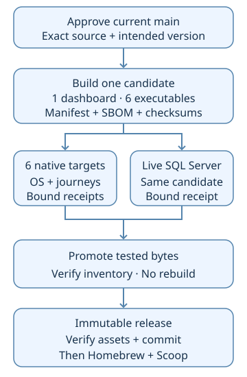

# 確認交付進度並接續工作

[English](./delivery.md) · [繁體中文](./delivery.zh-TW.md)

合併或接續發布前，先確認哪份來源與 binary 通過了哪些測試。
工具會把 GitHub 的即時證據存成本機 checkpoint；它不會取代 review、CI 或
既有的 release approval。

```bash
python3 scripts/delivery_status.py --pr 123 --workspace /path/to/task --json
```

使用已分配的 task workspace。啟動 release workflow 後，在同一條指令加上
精確的 `--release-run` ID 與 `--tag`。接續時再次提供相同 selectors，工具不會
用附近另一個 run 猜測發布結果。參數請見 `--help`。一般輸出摘要進度，JSON
保留各 job、attempt、耗時與候選檔案 digest。

Artifact metadata 只查指定的同一個 ID，最多三次 GET；每次最多 10 秒，
只有 404、HTTP 500/502/503/504 或 request timeout 會等待 0.5 秒、1 秒後重試。404 也可能
表示無權存取，不能當成 metadata 稍後一定出現的證據。明確的 401/403、rate limit、
格式錯誤及身分／digest／expiry 不符都直接失敗。Timeout 共用原本最多三次的
額度，不會重新計次。
這項有界讀取政策也用於 delivery observer，不會重新上傳或重送 publication。



## 流程驗證什麼

Producer 建立一次 dashboard 與六個產品 executable。Manifest 將來源 SHA、
預計版本、工具、輸入、run 與 producer attempt 綁定到各檔案 digest。
上傳後的 artifact ID、archive digest 與 manifest 另存成小型 identity artifact。

Native runners 驗證並執行這些 bytes，保留 source compilation、OS 測試、
installer fixtures、uninstall 與自動更新情境。所有 Unix targets 都執行 .NET
journey。SQL Server readiness 使用同一份 Linux candidate，publish engine
仍對真實 SQL Server 測試。成功後的 receipt 會綁定 artifact 與 binary digest。

Promotion 需要六個 native receipts 與 SQL 證據，直接複製測過的產物，保留
checksum、SBOM、provenance 與 immutable-release 驗證，不重建 dashboard
或產品 executable。正式發布仍是原本八個檔案。Source tests 的編譯與
installer 測試用的 fixture builds 另外計算。

相關 PR 會提早跑 native checks。只有明確的純文件路徑可顯示 no-op；未知
輸入或分類失敗不能繞過 gate。Linux .NET job 改為 blocking。發布會核對
最新 canonical main CI run 的實際 job 結果，包括 native gate，不只看可能
掩蓋單項失敗的 aggregate success。

PR 產物用於診斷。只有另行核准、來源仍為 current main 的 release workflow
能提升自己建立的 candidate。PR jobs 只有 repository read 權限，沒有 release
簽章權限。Branch protection 設定是另一層政策；這次強制的是 workflow 與
發布門檻。

## 接續時不重做已接受的動作

狀態改變、逾時或 agent 重啟後，再執行 observer。它會重新讀取 PR、issue、
job、candidate、release 與套件渠道的即時狀態，再更新 checkpoint。先看清楚
失敗或等待中的 job，再決定下一步。工具成功結束代表取得證據，不代表整個
交付已經通過。

只重跑失敗 job 時，可保留**相同 run 與來源**較早 attempt 的成功結果；
observer 取每個 job 最新的結果，新 failure 或 skip 不能被舊 success 蓋掉。
PR head 改變時，舊的 review 紀錄會失效。Agent 的 review notes 明確標為
reported，與 GitHub review decision 分開。

若發布已存在，先驗證 immutable assets 與 commit 確實對應 candidate，再
接續尚未完成的驗證或套件更新。不要重建另一份 bytes 或替換同一個 tag。
Promotion retry 會先確認已接受的相同發布，避免遺失回應後再次送出 create。

API 失敗會停止觀測，不把舊 checkpoint 當成新的成功。過期或缺少 artifact
代表證據不完整；重建的 candidate 必須重跑自己的 checks，不能沿用另一份
產物的 receipts。Observer 只讀小型 identity artifact，不在每次檢查下載全部
executable；binary 驗證仍由 native 與 promotion jobs 執行。

Checkpoint 只保留選定證據，不儲存 token、簽名 archive URL 或私人專案設定。
放在 task storage，工作完成後依儲存政策釋放；若需要長期報告，先另存成果。
Actions candidate artifacts 有保存期限。
