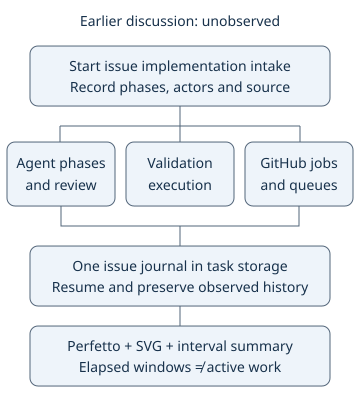

# Measure one development issue

[English](./development-measurement.md) · [繁體中文](./development-measurement.zh-TW.md)

Record one issue from implementation intake to post-merge verification, then
open its timeline in Perfetto. Use this optional workflow to find waits and
repeated work. It does not replace preflight, review or delivery approval.



## Start recording

Use allocated task storage outside every Git checkout. Run the script from the
repository; no analytics server, SDK or global telemetry setting is needed.

```sh
FLOW_WORKSPACE=/path/to/task
python3 scripts/flow_measure.py --workspace "$FLOW_WORKSPACE" init --issue 123
python3 scripts/flow_measure.py --workspace "$FLOW_WORKSPACE" begin \
  --stage requirements --actor author --source "$(git rev-parse HEAD)" \
  --label "Implementation intake"
```

The JSON result contains a `span` ID. End that phase with its ID:

```sh
python3 scripts/flow_measure.py --workspace "$FLOW_WORKSPACE" end \
  --span SPAN_ID --result passed
```

Start separate spans for concurrent reviewers, retaining each returned ID.
Use `--round` for another pass. `rework` and `waiting` require `--reason`,
such as `review finding` or `CI completion`. Labels are short descriptions,
not prompts, shell commands or credentials. `--source` is an exact commit or
source fingerprint at phase start; it does not certify later edits. Use the
reviewed commit/fingerprint for review spans.

`run` accepts the same phase arguments followed by `--` and a local command.
It records completion/failure or Ctrl-C/SIGTERM cancellation without storing command
arguments. An abrupt process/host exit leaves an unfinished span: inspect what
happened and explicitly close it with a truthful result before finishing the
session. Resume the same workspace without running `init` again.

## Import existing evidence

```sh
python3 scripts/flow_measure.py --workspace "$FLOW_WORKSPACE" import-check \
  --report "$FLOW_WORKSPACE/runs/RUN_ID/report.json"
python3 scripts/delivery_status.py --pr 123 --workspace "$FLOW_WORKSPACE" --json
python3 scripts/flow_measure.py --workspace "$FLOW_WORKSPACE" import-delivery \
  --report "$FLOW_WORKSPACE/orbit-delivery.json"
```

Use the actual PR number, which can differ from the issue number. Observe and
import after meaningful state changes, including failed CI before changing
the source. Imports keep already observed source heads/attempts. The final
delivery checkpoint alone is not a complete history. Foreign repository/issue
checkpoints are rejected. Repeated imports do not count the same execution
twice, and conflicting terminal evidence is rejected.

Validation execution uses the original run and source fingerprint. For reuse,
import the returned report with `reused` and `invoked_at`; the original stored
run report still describes the original execution. Reuse is a note, not another
test duration. Old reports without absolute times are noted without inferring
a start from file timestamps. Evidence predating this session is not silently
included as if it were recorded after intake.

## Read the result

```sh
python3 scripts/flow_measure.py --workspace "$FLOW_WORKSPACE" export
# After all recorded phases finish:
python3 scripts/flow_measure.py --workspace "$FLOW_WORKSPACE" finish
python3 scripts/flow_measure.py --workspace "$FLOW_WORKSPACE" export
```

Open `flow/trace.json` at [Perfetto](https://ui.perfetto.dev) with **Open trace
file**. `flow/timeline.svg` is the shareable summary and `flow/summary.json`
retains interval unions, failed/unfinished spans and notes. Files remain in
task storage; save the report before releasing that storage.

These are elapsed windows, not active coding/attention time. Stage totals can
overlap and must not be added together. The uncovered duration means there is
no completed interval evidence; an unfinished span does not establish success
or absence of work. GitHub queue time is job admission waiting, not CPU time.
Wall clocks must agree; inconsistent timestamps are rejected, not corrected by
guessing. Earlier requirements discussion and unobserved failed attempts remain
unknown. A single issue is a pilot sample, not a productivity or speedup claim.

## Event contract

`flow/journal.json` uses `orbit.flow.v1`: repository, issue, session start/end,
and append-only `begin`, `end`, `note` events. Begins carry ID, UTC timestamp,
stage, actor, source, label, round, provenance and an optional reason. Ends carry
the same ID, timestamp and `passed`, `failed`, `cancelled` or `unknown`. Parallel
events use a short journal lock independent of the long validation lock.
The journal is atomically replaced; malformed/conflicting history fails closed.

Phase events are agent-reported windows. Imported validation timestamps are
tool-reported execution; GitHub job timestamps come from the delivery observer.
These records are observational and never authorize commit, merge or release.
Use `--help` for command details. Full local checks run on macOS/Linux or WSL;
this workflow does not expand Windows Beta's existing Go-only validation scope.
