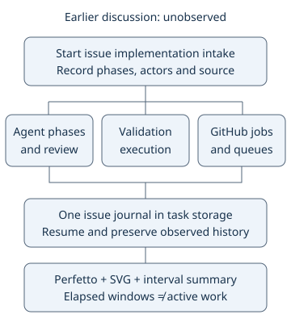

# 量測一張開發 issue

[English](./development-measurement.md) · [繁體中文](./development-measurement.zh-TW.md)

從實作 intake 開始記錄，到合併後驗證結束，再用 Perfetto 查看時間線。
這是找出等待與重工的選用流程，不取代 preflight、review 或發布核准。



## 開始記錄

先依開發儲存政策配置 Git checkout 外的 task 目錄。從 repo 執行腳本，
不必部署分析服務、安裝 SDK 或修改全域 telemetry 設定。

```sh
FLOW_WORKSPACE=/path/to/task
python3 scripts/flow_measure.py --workspace "$FLOW_WORKSPACE" init --issue 123
python3 scripts/flow_measure.py --workspace "$FLOW_WORKSPACE" begin \
  --stage requirements --actor author --source "$(git rev-parse HEAD)" \
  --label "Implementation intake"
```

JSON 會回傳 `span` ID，結束該階段時使用它：

```sh
python3 scripts/flow_measure.py --workspace "$FLOW_WORKSPACE" end \
  --span SPAN_ID --result passed
```

平行 reviewer 各開一個 span，保留各自的 ID；下一輪使用 `--round`。
`rework` 與 `waiting` 必須提供 `--reason`，例如 `review finding`、
`CI completion`。標籤只描述工作，不放 prompt、完整指令或憑證。
`--source` 是階段開始時的精確 commit 或來源 fingerprint，不代表之後
修改已通過驗證。Review span 應填實際受審的來源 identity。

`run` 接受同樣的階段參數，後面加 `--` 與本機指令；會記錄成功、失敗或
Ctrl-C／SIGTERM 取消，不儲存指令參數。程序或主機突然退出時，span 保留未完成；
先查明結果，再以真實狀態結束它。恢復時沿用同一 workspace，不要重新 init。

## 匯入既有證據

```sh
python3 scripts/flow_measure.py --workspace "$FLOW_WORKSPACE" import-check \
  --report "$FLOW_WORKSPACE/runs/RUN_ID/report.json"
python3 scripts/delivery_status.py --pr 123 --workspace "$FLOW_WORKSPACE" --json
python3 scripts/flow_measure.py --workspace "$FLOW_WORKSPACE" import-delivery \
  --report "$FLOW_WORKSPACE/orbit-delivery.json"
```

填實際 PR 號碼，不一定與 issue 相同。在重要狀態改變後觀察並匯入；CI
失敗時，先記錄，再修改來源。工具保留已觀測的來源與 attempt，最後一份
delivery checkpoint 不代表完整歷史。其他 repo／issue 的 checkpoint 會被拒絕；
重複匯入不重複計算執行，互相矛盾的終止證據也會被拒絕。

驗證紀錄綁定原 run 與來源 fingerprint。重用時匯入回傳的 `reused`、
`invoked_at`；原本磁碟上的 report 仍描述舊執行。重用只是一則紀錄，
不再加算舊測試時間。舊 report 缺絕對時間時會標示缺漏，不用檔案 mtime
倒推起點；早於本次 intake 的資料也不會被悄悄算進來。

## 查看結果

```sh
python3 scripts/flow_measure.py --workspace "$FLOW_WORKSPACE" export
# 所有已記錄階段結束後：
python3 scripts/flow_measure.py --workspace "$FLOW_WORKSPACE" finish
python3 scripts/flow_measure.py --workspace "$FLOW_WORKSPACE" export
```

到 [Perfetto](https://ui.perfetto.dev)，用 **Open trace file** 開啟
`flow/trace.json`。`flow/timeline.svg` 可放進報告；`flow/summary.json`
保留區間聯集、失敗／未完成 span 和註記。資料留在 task storage，釋放前
先保存需要長期保留的報告。

這些是階段經過時間，不是持續寫程式或專注的時間。各階段可能重疊，
不能直接相加。未覆蓋時間表示沒有完整區間證據；未完成 span 不代表
成功，也不代表期間沒有工作。GitHub 排隊時間是 job 等候執行，不是 CPU
時間。時間不一致會被拒絕，不猜測校正。原始需求討論與未觀測到的失敗
attempt 仍是未知；單張試跑不能用來宣稱生產力或固定加速幅度。

## 事件契約

`flow/journal.json` 使用 `orbit.flow.v1`：repo、issue、session 起訖，
以及只追加的 `begin`、`end`、`note` 事件。Begin 含 ID、UTC 時間、stage、
actor、source、label、round、provenance 和選用 reason；end 含相同 ID、
時間及 `passed`、`failed`、`cancelled`、`unknown`。短時間 journal lock
獨立於長時間 validation lock；以原子替換寫檔，歷史格式錯誤或衝突就停止。

階段視窗由 agent 回報；驗證時間由工具回報；GitHub job 時間來自 delivery
observer。以上都只是觀測，不授權 commit、merge 或 release。
指令細節見 `--help`。完整本機檢查使用 macOS／Linux 或 WSL；此功能不
擴大 Windows Beta 原有僅 Go 驗證的支援範圍。
