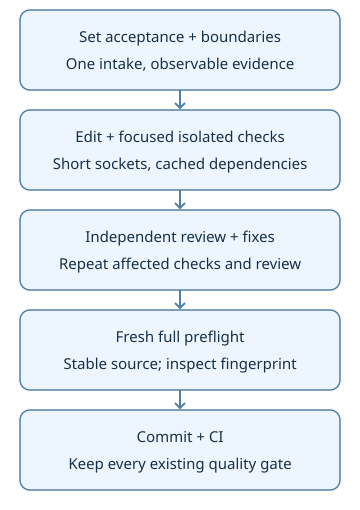

# Development

[English](./development.md) · [繁體中文](./development.zh-TW.md)

Build Orbit from source, run tests, or maintain a custom distribution.

## Contributing to Orbit

### Testing unreleased main

Requires the Go version in `go.mod`, Node.js 22+, pnpm 10+, Python 3.9+, and Make:

```bash
git clone https://github.com/iml885203/orbit.git
cd orbit
pnpm --dir ui install
make install
orbit version
orbit init
```

`make install` builds current source and deliberately makes it the one `orbit`
on your normal PATH. It preserves the replaced binary at
`~/.local/bin/orbit.prev` and prints a daemon restart reminder, so a published
release and a source build do not silently compete. Run `orbit version` after
switching to confirm which build you are testing.

For a one-off build that must not replace the installed release, use
`make build` and invoke `./bin/orbit` explicitly. Stop any daemon started by
that binary before returning to the installed `orbit`.

### Development workflow

```bash
make build         # Build frontend + Go binary
make test          # Go + dashboard behavior tests
make preflight     # Full source, static, installer, and documentation gate — once per coherent commit
make test-journeys # Installed binary through real Git, process, and Docker boundaries
make lint          # Run linter
make setup         # Install git hooks
```

Keep the edit loop proportional to the change: run the narrowest relevant
sociable test while editing, `make test` after a coherent product slice,
and `make preflight` once before committing it. Do not create a release for
each fix. Accumulate related fixes behind one user outcome, review the release
candidate as a whole, then publish one version.

### Isolated checks

Keep build output and test state outside the checkout. Allocate one task
workspace with your storage policy, then reuse that path while editing:

```bash
python3 scripts/dev_check.py go --workspace /path/to/task --package ./internal/engine
make check-full CHECK_WORKSPACE=/path/to/task CHECK_JOBS=2
```



The runner copies tracked and non-ignored new files, including local edits.
It keeps dependencies, generated files, logs, caches and runtime homes in the
workspace. A short temporary socket alias points there and is removed on exit.
Your installed Orbit and daemon are not part of these checks. Tests still need
available local ports; run Docker journeys separately with their prerequisites.

Use `python3 scripts/dev_check.py --help` for modes, timeouts and JSON reports.
`go`, `ui` and `docs` are edit-loop checks. `full` runs the existing complete
`make preflight`; run it fresh before **every commit**, after the last edit.
Full checks never reuse a previous success. Narrow checks accept `--reuse`
only when source, Git tags, tools, options and inherited environment match.
Changes during a run invalidate its success. This is local evidence, not
release approval or a substitute for CI.

Reports and stage logs remain under `reports/` and `runs/` in the workspace.
A failure, timeout or cancellation never becomes a reusable success; inspect
the log and rerun after fixing it. Only one check owns a workspace at a time.
Interrupted processes release the lock; after a machine crash inspect any
remaining test processes before rerunning. Release the workspace using your
storage policy when the whole task ends. `--storage-helper PATH` can allocate
it with `PATH create orbit-validation`; allocation errors stop without fallback.

Python 3.9+, Make and Go are required for Go mode; other modes also need Node
and pnpm. Windows Beta supports Go mode with those tools; use WSL or CI for
full/UI/docs. Standard macOS Chrome is detected for website checks; otherwise
the existing Playwright setup applies. External Go workspaces, overlay/modfile
flags and custom UI distribution overrides need their own verification workflow
and are rejected by this runner.

### Prevent new Go lint debt

Install the version in `.golangci-lint-version`, then run `make lint-new`.
It checks the complete Linux/amd64 inventory against
`.golangci-baseline.json`; removing an old finding cannot offset a new one.
After fixing legacy debt, run `python3 scripts/lint_gate.py --ratchet` and
review the baseline reduction with the code. CI compares that inventory with
the exact base commit and rejects expansion. `make lint` remains the stricter
all-findings view; existing debt is not a clean lint result.

Release numbering and compatibility promises are documented in
[Versioning and compatibility](versioning.md).

#### Dashboard development (hot reload)

```bash
cd ui && pnpm dev          # Vite dev server on :5173
orbit daemon start         # API backend + dashboard on :19800
```

## Build a custom Orbit distribution

When config alone is insufficient, a team can fork this repository and register its own feature set in `cmd/orbit`, passing additional `extension.Extension` values to `app.Main`. Each extension can contribute CLI commands, daemon setup and hooks, doctor and init behavior, and distribution defaults; see [internal/extension/extension.go](https://github.com/iml885203/orbit/blob/main/internal/extension/extension.go). The packages are internal, so this works only inside a fork: Orbit has no public Go API ([versioning](versioning.md#stable-contracts-from-v1)).

The UI build retains three compile-time seams in [ui/vite.config.ts](https://github.com/iml885203/orbit/blob/main/ui/vite.config.ts):

- `ORBIT_UI_EXT` replaces the `$ext` module with a team's navigation, routes, panels, settings sections, and lifecycle hooks.
- `ORBIT_UI_TYPES` replaces the generated-types barrel.
- `ORBIT_UI_OUTDIR` selects the dashboard build output embedded by the team's binary.

This route means maintaining a custom build and release line. Use it only for behavior that cannot be expressed in env configuration, and keep neutral improvements in this repo rather than duplicating the core.
