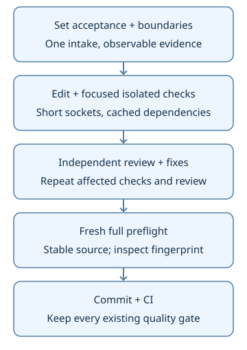

# 開發

[English](./development.md) · [繁體中文](./development.zh-TW.md)

從原始碼建置 Orbit、執行測試，或維護自訂發行版。

## 貢獻 Orbit

### 測試尚未發布的 main

需要 `go.mod` 指定的 Go 版本、Node.js 22+、pnpm 10+、Python 3.9+ 與 Make：

```bash
git clone https://github.com/iml885203/orbit.git
cd orbit
pnpm --dir ui install
make install
orbit version
orbit init
```

`make install` 會 build 目前 source，並刻意讓它成為一般 PATH 上唯一使用的
`orbit`。被替換的 binary 會保留在 `~/.local/bin/orbit.prev`，安裝完成也會
提醒重啟 daemon，避免已發布的 release 與 source build 在不知情下互相競爭。
切換後執行 `orbit version`，確認目前測試的是哪個 build。

若只想做一次性 build、不替換已安裝的 release，請執行 `make build`，並明確
使用 `./bin/orbit`。回到已安裝的 `orbit` 前，先停止由該 binary 啟動的 daemon。

### 開發流程

```bash
make build         # Build frontend + Go binary
make test          # Go 與 dashboard 行為測試
make preflight     # 完整 source、靜態、installer、文件 gate；每個完整 commit 跑一次
make test-journeys # 真實 Git、process、Docker 邊界下驗收已 build 的 binary
make lint          # Run linter
make setup         # Install git hooks
```

修改期間先跑最貼近變更的 sociable test；完成一組連貫的產品改善後跑
`make test`，commit 前再跑一次 `make preflight`。不要每修一點就發布；
先把同一個使用者結果相關的修改集中起來，整體 review release candidate，
再發布一個版本。

修改前先整理簡短的驗收與證據對照：哪些行為必須成立、各邊界怎麼驗證，
以及哪些不在範圍內。指令與契約的選擇在 intake 定清楚，並沿用作為 review 輸入。

需要獨立 review 時，先跑隔離的 focused checks，在修改成本還低時 review。
修正 findings，重跑受影響的檢查與 review；來源穩定後，才在 commit 前跑全新的
完整 gate。完整驗證執行期間不要再修改該來源；輸入有變就必須重新跑，舊成功
不能授權修改後的 commit。調整的是順序，必要檢查一項也不減。

### 隔離驗證

用既有儲存政策建立一個 task workspace，編輯期間沿用同一路徑。
檢查會複製目前修改與未被忽略的新檔案，把依賴、產物、測試狀態與紀錄留在
workspace；短 socket 別名會在結束後移除。檢查不使用已安裝的 Orbit 或 daemon。
測試仍需要可用連接埠；Docker journeys 另外依其前置條件執行。

```bash
python3 scripts/dev_check.py go --workspace /path/to/task --package ./internal/engine
make check-full CHECK_WORKSPACE=/path/to/task CHECK_JOBS=2
```



模式與參數以 `python3 scripts/dev_check.py --help` 為準。
`go`、`ui`、`docs` 用於編輯迴圈；`full` 執行完整 `make preflight`，每次
commit 前、最後一次修改後都必須重新跑。完整檢查不能重用；快速檢查只有在
來源、Git tags、工具、選項與繼承環境相符時，才可用 `--reuse` 重用成功結果。
執行期間來源改變會使結果失效。這是本機證據，發布仍須通過 CI 與交付門檻。

報告與各階段 log 留在 workspace 的 `reports/` 與 `runs/`。
失敗、逾時、取消都不能重用；先看 log、修正後重跑。同一個 workspace 只能
同時跑一個檢查；process 結束會釋放鎖。機器異常重啟後，先確認沒有殘留測試
process。整個 task 結束時，依儲存政策釋放 workspace。
`--storage-helper PATH` 可執行 `PATH create orbit-validation` 分配空間；
分配失敗就停止，不會改用其他目錄。

Go 模式需要 Python 3.9+、Make 與 Go；其他模式還需要 Node 與 pnpm。
Windows Beta 支援 Go 模式；full/UI/docs 使用 WSL 或 CI。
macOS 會偵測標準安裝的 Chrome，其他環境沿用 Playwright setup。
外部 Go workspace、overlay/modfile flags 與自訂 UI distribution override
不適用這個入口，會直接拒絕，請使用自己的驗證流程。

### 不新增 Go lint 債務

安裝 `.golangci-lint-version` 指定版本後執行 `make lint-new`。
它用完整 Linux/amd64 finding 比對 `.golangci-baseline.json`，不以總數抵銷。
修好舊問題後，跑 `python3 scripts/lint_gate.py --ratchet`，將減少的基準與
程式一起 review。CI 會比對精確 base commit，拒絕擴大基準。
`make lint` 仍顯示所有問題；保留舊債不代表 lint 已經全綠。

候選產物驗證與重啟後接續請見[確認交付進度](delivery.zh-TW.md)。
若要選用涵蓋開發、測試與 review 的 issue 時間線，請見
[量測一張開發 issue](development-measurement.zh-TW.md)。
完整 gate 也會用固定版本的 actionlint 驗證 GitHub workflow 語義。

Release 編號與相容性承諾請見[版本與相容性](versioning.zh-TW.md)。

#### Dashboard 開發（hot reload）

```bash
cd ui && pnpm dev          # Vite dev server on :5173
orbit daemon start         # API backend + dashboard on :19800
```

## 維護自訂的 Orbit 發行版

當純設定不夠用時，團隊可 fork 這個 repository，在 `cmd/orbit` 註冊自己的功能，把額外的 `extension.Extension` 傳給 `app.Main`。每個 extension 可提供 CLI commands、daemon setup 與 hooks、doctor 與 init 行為，以及 distribution defaults；請見 [internal/extension/extension.go](https://github.com/iml885203/orbit/blob/main/internal/extension/extension.go)。這些 package 都在 internal 底下，所以只能在 fork 內使用：Orbit 沒有公開的 Go API（見 [versioning](versioning.zh-TW.md)）。

UI build 在 [ui/vite.config.ts](https://github.com/iml885203/orbit/blob/main/ui/vite.config.ts) 保留三個編譯時 seam：

- `ORBIT_UI_EXT` 用團隊的 navigation、routes、panels、settings sections 與 lifecycle hooks 取代 `$ext` module。
- `ORBIT_UI_TYPES` 取代 generated-types barrel。
- `ORBIT_UI_OUTDIR` 選擇由團隊 binary embed 的 dashboard build output。

這條路線代表團隊必須自行維護 build 與 release line。只在 env 設定無法表達需求時使用，並將中性改進留在這個 repo，避免複製 core。

## 讀取 CI 驗證範圍

透過 [delivery observer](./delivery.zh-TW.md#一般-ci-的驗證範圍) 查看選定的原生 profile 與實際檢查。一般功能／UI 可使用 Linux 驗證；主機、建置、政策或不確定的變更使用完整驗證。本機 fresh preflight 與 review 要求不變。手動選擇的 Linux 診斷不能當作正式 main CI 或發布證據。
