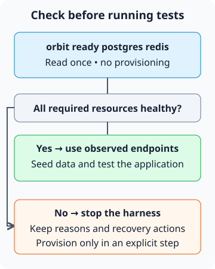

# E2E 測試

[English](./e2e-testing.md) · [繁體中文](./e2e-testing.zh-TW.md)

用 Orbit 啟動 E2E 測試需要的資料庫、快取和訊息服務。測試程式負責準備自己的資料，
並在執行前確認環境已就緒。

## 基礎設施與測試資料

把整個 stack 分成三層，各有各的擁有者：

| 層 | 擁有者 | 生命週期 |
|---|---|---|
| 基礎設施（database、cache、broker） | Orbit（`orbit up --infra`） | 長駐，與日常開發共用 |
| 測試資料（專屬的 database 或 schema） | 測試 harness | 可拋棄，scenario 之間重置 |
| 受測系統（app runtime） | 測試 harness | 每次執行以測試 profile 啟動 |

### 資料庫隔離


開發用程式連到 `app_dev`，測試設定連到 `app_e2e`。透過各自的連線設定指定
資料庫名稱。如果使用 SQL Project，將 `app_e2e` 設為 publish 目標，跑
`orbit sqlserver publish app_e2e` 後再建立測試資料。重設前先確認目標是
`app_e2e`，名稱不符就中止。兩套應用程式若同時運行，請各用一個 port。

本機 SQL Project 的 publish 方式見 [SQL Projects](sql-workflow.zh-TW.md)。

## 環境就緒檢查

`orbit switch` 會停掉運行中的資源並重啟 daemon。它是機器層級的 provisioning
步驟：放在 pipeline 的 setup 階段或由人親手輸入是對的，作為跑測試的隱式副作
用是錯的。Orbit 會強制這件事——有資源運行時，`switch` 會要求確認，非互動的
caller 必須加 `--yes`。



harness 開跑前只驗證套件需要的資源。先確認 `orbit ready --help` 支援這個指令。
若已裝 CLI 尚未提供，回報 `orbit version --json`，在明確更新 CLI 後才採用下方
範例。既有 harness 可保留自己透過 `orbit env info --json` 與
`orbit status --json` 實作的唯讀身分／必要資源檢查；這兩個查詢本身不是斷言。
不要把不支援的指令解讀成資源不健康，也不要略過 guard 繼續跑。

```bash
# 如需 provisioning，另設明確的 setup 步驟。
orbit ready postgres redis --json > readiness.json || exit 1
# 使用 readiness.json 的 data.resources[].ports／url 設定應用程式。
# 準備隔離的測試資料，再執行真正的應用程式斷言。
```

只需資料庫的套件不會被已停止的前端阻擋。這個 guard 不會啟動、切換或等待
資源。失敗時保留原因及帶完整 config／instance 的恢復指令，交給人或
provisioning 階段決定；不要把恢復動作當成測試的隱式副作用。

[就緒斷言契約](agent-cli.md#required-resource-readiness-assertion)維護完整結果
形狀和全域 blockers，包含尚未套用的設定。需要宣告 metadata 時另讀
`orbit env info --json`；需要完整生命週期細節時讀 `orbit status --json`。
這兩個查詢都不是斷言 guard。

失敗時 `orbit up --json` 自帶證據：`data.failed_resources` 列出每個沒有變
healthy 的資源，含狀態、原因與有上限的 log tail。CI log 不需要第二個指令就能
看到解釋。payload 形狀見 [agent CLI contract](agent-cli.zh-TW.md)。

## Instances

專屬 runner 或 dev 環境旁的第二個 stack，請為該次執行指定唯一 named instance：

```bash
orbit up --instance ci-$BUILD_ID --infra --json
orbit ready postgres redis --instance ci-$BUILD_ID --json
# 使用 data.resources 回報的 resolved endpoints 執行測試
orbit instance clean ci-$BUILD_ID --json
```

Named instance 會隔離 daemon state、Docker resources、volumes、networks 與 host
ports。宣告 ports 是 preferences；JSON response 會回報解析後的 endpoints，test
harness 必須使用它們，不能假設 environment 檔裡的 ports。整次執行的每個 Orbit
command 都要維持相同 `--instance` target，並在 suite 結束後清理。Ownership model
見[隔離的 runtime instances](instances.zh-TW.md)。

若 CI 的 Docker daemon 或 storage driver 無法穩定處理並行 image 解壓縮，請使用
[設定](configuration.zh-TW.md#settings)中的 pull 併發上限，而不必另外維護 image
預拉清單。

## BigQuery

[BigQuery 開發與整合測試](./bigquery.zh-TW.md) 說明選用環境設定、CLI prepare/inspect/list/clean、ADC 身分、只讀 dashboard，以及離線證據與真實 GCP E2E 的差異。`orbit bq` 使用標準 `orbit.cli.v1` JSON envelope；sandbox inspect/list 不連雲端。明確 clean 需 `--yes --app-stopped --restricted-writers`，停止環境不會刪除 dataset。
